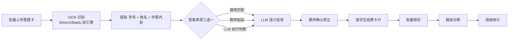
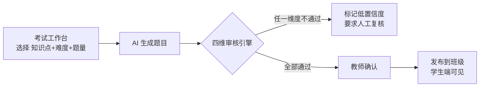
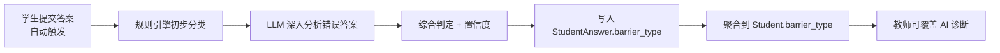
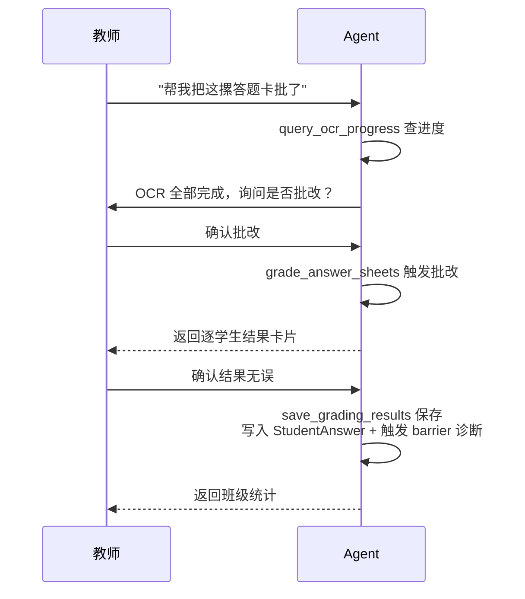
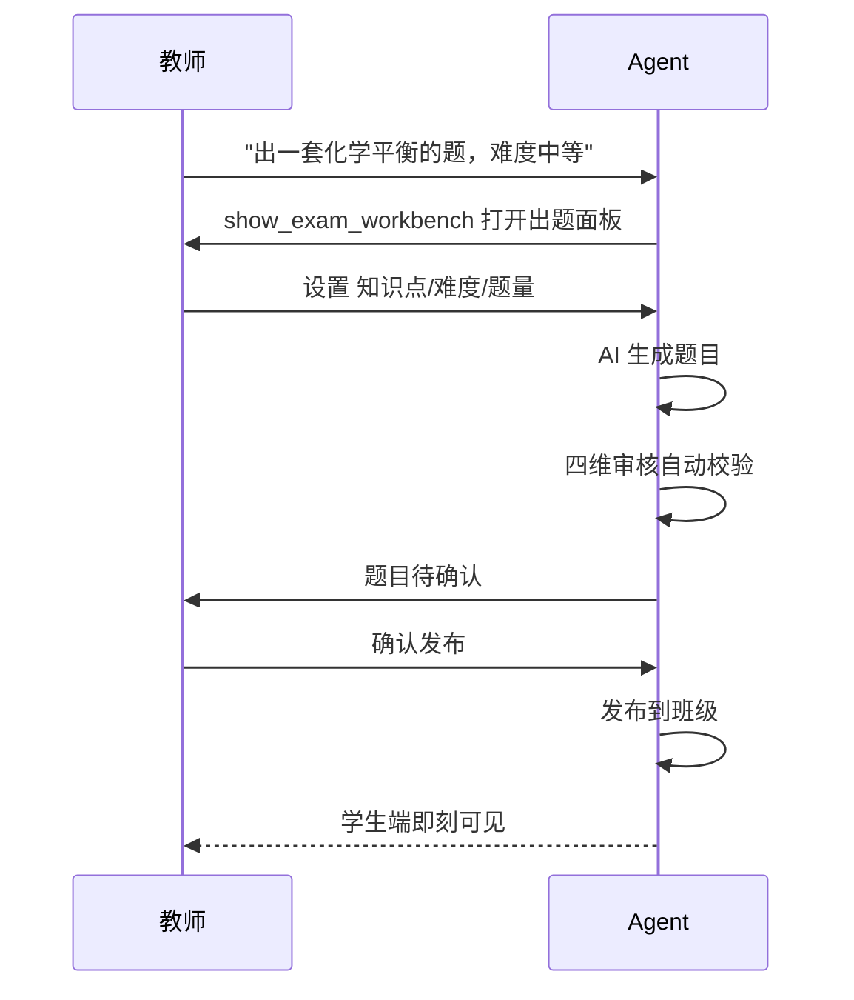
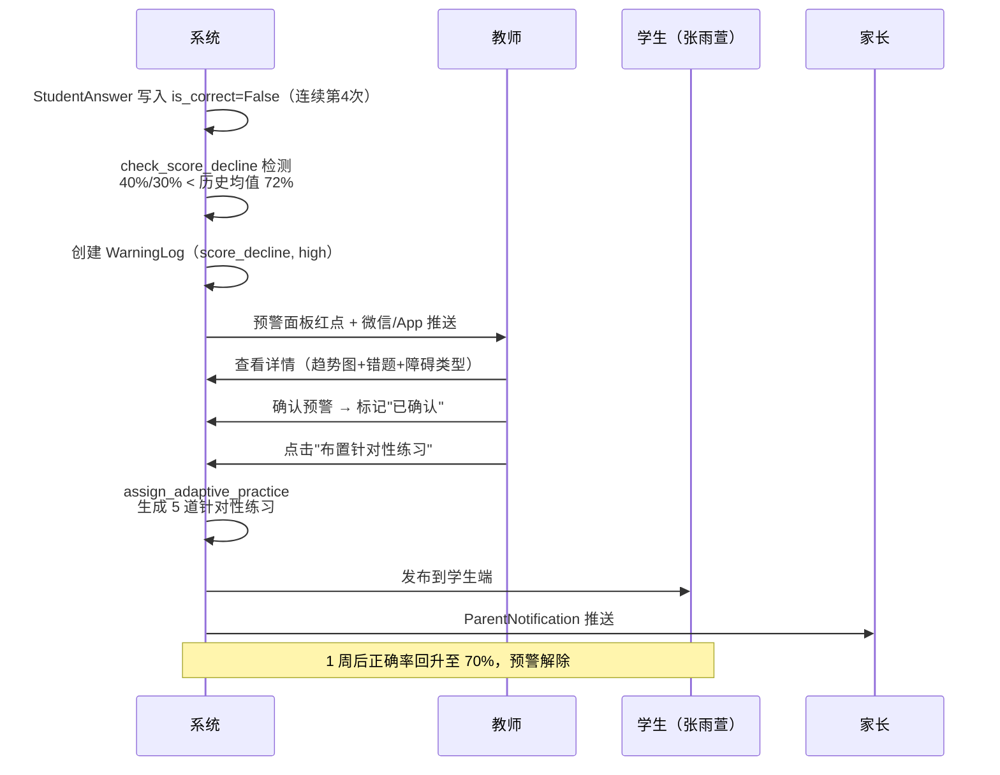

# 智辅化学 (ChemAI) — 产品需求文档 (PRD)

> **版本**: v4.3
> **撰写人**: 陈思远
> **日期**: 2026-07-09（初稿 2026-03-14）
> **状态**: 生产阶段

---

## 目录

1. [执行摘要](#1-执行摘要)
2. [产品范围与边界](#2-产品范围与边界)
3. [用户画像与角色体系](#3-用户画像与角色体系)
4. [核心模块详细设计](#4-核心模块详细设计)
5. [Model Story](#5-model-story)
6. [Agent 架构设计](#6-agent-架构设计)
7. [Chem Skills 技能体系](#7-chem-skills-技能体系)
8. [服务层架构](#8-服务层架构)
9. [数据模型](#9-数据模型)
10. [API 端点全景](#10-api-端点全景)
11. [Persona 设计](#11-persona-设计)
12. [行为约束与安全护栏](#12-行为约束与安全护栏)
13. [失败模式目录](#13-失败模式目录)
14. [评测体系](#14-评测体系)
15. [风险评估矩阵](#15-风险评估矩阵)
16. [技术架构](#16-技术架构)
17. [开发阶段与完成度](#17-开发阶段与完成度)
18. [北极星指标与增长策略](#18-北极星指标与增长策略)
19. [附录](#19-附录)

---

## 1. 执行摘要

### 1.1 产品定义

智辅化学 (ChemAI) 是一款面向中国高中化学教师、学生和家长的三端 AI Agent 教学平台。产品以 LangGraph 驱动的单 Agent ReAct 架构为核心，将 AI 出题、四维安全审核、答题卡 OCR 批改、LLM 错题诊断、自适应练习、间隔复习、学情报告等全链条教学环节数字化与智能化。

教师以自然语言与 Agent 交互，即可完成从"收到一沓答题卡"到"掌握全班学情、下发个性化练习"的完整闭环。学生在 AI 助教的引导下逐步推导出答案，而非被动获取答案。

### 1.2 问题陈述

高中化学教师需要高效精准的作业批改、出题、学情诊断能力，因为化学题目涉及方程式配平、离子方程式拆分、物质推断等专业判断，手工统计错题耗时巨大（每次考试 6-10 小时），且通用 AI 在方程式配平上有幻觉风险。市面产品缺乏从批改→诊断→出题→练习→复习的完整闭环。

ChemAI 把这个时间压缩到 3 分钟——提供批改、诊断、自适应练习的一体化 AI 方案。

### 1.3 核心红线

**化学方程式系数配平必须零错误。** 所有 AI 生成的方程式必须通过四维安全审核引擎（配平/条件/产物/结构）拦截校验。

### 1.4 北极星指标

ChemAI 属于**生产力游戏（Productivity Game）**——核心价值是"帮人完成工作任务更高效"。北极星指标为：

> **月诊断错题数（MDEI — Monthly Diagnosed Error Items）**

该指标通过了 7 项标准验证（易于理解、客户中心、可持续价值、可量化、可行动、先行指标、愿景对齐），由 5 个输入指标驱动：上传答题卡数、诊断采纳率、活跃老师数、OCR 诊断覆盖率、上传到诊断完成的时间。MDEI 领先于学校续约率约 3-6 个月。约束反指标包括诊断被人为修改率、学生报告查看率、家长端月活/诊断学生数。

种子期目标：5,000-10,000/月 → 推广期：50,000/月 → 规模期：200,000+/月。

#### 1.4.1 候选 NSM 完整排除逻辑

在确定 MDEI 之前，4 个候选 NSM 经过系统排除：

| 候选 NSM | 排除理由 | 危险 |
|----------|---------|------|
| **周活跃老师数** | 规模指标非价值指标。10 个老师每人诊断 10 道题 vs 5 个老师每人诊断 200 道题，后者价值更大但前者"周活"赢 | 团队会优化"让更多老师登录"而非"让少数老师诊断更多错题"，本末倒置 |
| **学生练习完成数** | 诊断的下游行为，受太多外部因素影响（老师是否布置、学生是否有时间） | 如果选它做 NSM，会误导团队过早优化练习体验而忽视诊断准确率——诊断都不准，练习再多也没用 |
| **教师节省总时间** | 衡量标准不可靠，因人而异。不同老师手工批改速度天差地别（快则 2h 慢则 10h），基线不一致 | "节省的时间"在不同学校是 2h 还是 8h 完全取决于该老师原本有多慢——不是产品价值的真实反映 |
| **学校续约率** | 滞后指标。等到续约失败才知道出问题，已经没有时间挽救了 | 从"问题出现"到"续约失败"间隔 3-6 个月——MDEI 领先于续约率正好构成预警窗口 |

**7 项标准验证结果：**

| 标准 | 验证 | 说明 |
|------|:---:|------|
| 易于理解 | Pass | "每月系统自动诊断了多少道错题"，任何人都能懂 |
| 客户中心 | Pass | 诊断错题是教师的核心痛点，直接体现"帮老师省了多少事" |
| 可持续价值 | Pass | 老师用得越多诊断越多，MDEI 自然增长——不需要额外付费激励 |
| 可量化 | Pass | SQL `COUNT(DISTINCT student_answer_id WHERE barrier_type IS NOT NULL)` |
| 可行动 | Pass | MDEI 下降了，从 5 个输入指标定位根因并采取行动 |
| 先行指标 | Pass | MDEI 领先于续约率 3-6 个月；高 MDEI 学校续约意愿显著更高 |
| 愿景对齐 | Pass | 高 MDEI = 高效率诊断 = 更精准教学 = 真正的教育质量提升 |

#### 1.4.2 反指标体系（8 条完整列表）

增长不能以牺牲质量为代价。以下反指标含黄线（警告）/红线（停功能）阈值：

| # | 反指标 | 黄线阈值 | 红线阈值 | 触发动作 |
|---|--------|---------|---------|---------|
| 1 | 诊断被人为修改率 | >30% | >40% | 红线：暂停自动诊断，排查模型退化 |
| 2 | 学生报告查看率 | <40% | <25% | 黄线：检查学生端 UX；红线：全面排查触达链路 |
| 3 | 家长端月活/诊断学生数 | <30% | <15% | 黄线：优化推送时间/文案 |
| 4 | 危险化学内容生成次数 | — | >0 | 红线：**立即暂停出题功能**，全面审核 |
| 5 | 平均每老师诊断量单月增幅 | >50% | >80% | 黄线：可能有个别老师质量异常，抽样核查 |
| 6 | 诊断后学生未做练习比例 | >60% | >80% | 黄线：教师未布置或学生无动力，需干预 |
| 7 | 超出预期的 LLM API 每日费用 | 日均 +50% | 日均 +100% | 黄线：检查是否有死循环调用 |
| 8 | 跨角色数据泄漏报告 | — | >0 | 红线：**立即下线 Agent 对话功能**，修复并全面回归验证 |

### 1.5 当前关键指标

| 维度 | 指标 | 当前值 |
|------|------|--------|
| 效率 | 教师批改+诊断时间 | 从 6h → 约 27min（约 94%） |
| 质量 | AI 诊断教师采纳率 | 82% |
| 评测 | 确定性评测通过率 | 100%（86/86） |
| 评测 | API 评测通过率 | 100%（36/36） |
| 规模 | Agent 工具数 | 33 个（修正：原 v2 版本为 22→30→现已扩展至 33） |
| 评测 | 评测场景数 | 111 个（14 维度） |

---

## 2. 产品范围与边界

### 2.1 功能模块全景

| 编号 | 模块 | 状态 | 说明 |
|------|------|:---:|------|
| M1 | 用户与认证 | ✅ | JWT 四角色账户体系 |
| M2 | 学校/班级管理 | ✅ | 学校/年级/班级 CRUD |
| M3 | 教师入驻审核 | ✅ | 申请→审批→创建账户 |
| M4 | 答题卡 OCR 批改 | ✅ | 批量上传→OCR识别→LLM批改→班级统计 |
| M5 | AI 出题 + 四维审核 | ✅ | 知识点出题→审核→确认→发布 |
| M6 | 历年真题库 | ✅ | 搜索/筛选/向量相似匹配 |
| M7 | 错题报告 | ✅ | 教师版+学生版+班级统计 |
| M8 | 学生障碍诊断 | ✅ | concept/reading/expression 三维分类 |
| M9 | 个性化学习计划 | ✅ | LLM 生成 + 24h 缓存 |
| M10 | 自适应练习 | ✅ | 基于 ZPD + 障碍类型 + 薄弱知识点 |
| M11 | 错题强化训练 | ✅ | 变式题生成 + 训练会话 |
| M12 | 间隔复习 | ✅ | 艾宾浩斯 5 级掌握度 |
| M13 | 学情预警 | ✅ | 未登录/成绩下滑/错题率高三类 |
| M14 | 数据分析 | ✅ | 热力图/排名/分布/趋势 |
| M15 | 学情面板 | ✅ | 知识点×学生×时间三维 |
| M16 | 家长端 | ✅ | 周报/通知/绑码 |
| M17 | 消息通知 | ✅ | 多通道通知 |
| M18 | LMS 集成 | ✅ | 钉钉/企微/LTI |
| M19 | 操作日志 | ✅ | 全系统审计 |
| M20 | Agent 对话 | ✅ | v2 单 Agent + SSE 流式 |
| M21 | MCP 工具服务器 | ✅ | 15+ 外部工具 |
| M22 | 知识图谱 | ✅ | ChromaDB + 50+ 知识点 |
| M23 | 文档解析 | ✅ | MinerU + OCR 双引擎 |
| M24 | 导出服务 | ✅ | Word/HTML/PDF |
| M25 | 浏览器自动化 | ✅ | Playwright 5 tools |
| M26 | 评测体系 | ✅ | 14 维度 111 场景 |

**系统架构总览**


> 本图为整个产品的完整系统架构总览（原图见 `docs/CHEMAI架构图精简版.png`，完整版见 `docs/CHEMAI架构图.png`）；Agent 内部细节见第 6 章，服务层见第 8 章，数据模型见第 9 章，API 见第 10 章，技术选型见第 16 章。

#### 2.1.1 分阶段实施计划

基于 RICE/ICE/Kano 综合排序的 Phase 1-6 模块级清单、工作量汇总，及 Phase 7-12 总览，见 **17 章实施路线图（17.1）**——该表是实施计划的唯一权威副本。

### 2.2 硬性边界

- 绝不生成涉及危险化学品制备的详细步骤
- 绝不在未通过审核引擎的情况下输出化学方程式答案
- 绝不编造真题来源
- 不存储学生真实姓名与身份证号等敏感个人信息
- 学生报告不展示排名或他人分数
- 家长端不展示其他学生信息或班级排名
- 低置信度诊断结论标记"建议人工复核"

---

## 3. 用户画像与角色体系

### 3.1 四角色 + 四 Persona

| 角色 | 核心场景 | Persona | 使用频率 |
|------|----------|---------|----------|
| 化学教师 | 出题、批改、诊断、看学情 | teacher | 每日 |
| 学生 | AI 辅导对话、做练习、看错题 | student | 每周 2-3 次 |
| 家长 | 查看周报、接收通知 | parent | 每月 1-2 次 |
| 管理员 | 学校/年级管理、审核教师 | — | 每周 1-2 次 |

ChemAI 有四套 Persona YAML 配置（student/teacher/tutor/parent），控制每个角色的 system_prompt 和可见工具集。工具集通过两层过滤机制——YAML 白名单 ∩ TOOL_META 注册——再附加 5 个 Browser 工具。评测验证角色隔离 100% 无泄漏。

#### 3.1.1 角色工具约束

各角色 Persona 控制其可见工具集，范围如下：

| 角色 | 工具范围 | 实际可见 |
|------|----------|:---:|
| teacher | 全量（出题/题库/诊断/批改/辅导/记忆/文档解析等） | 31（含 5 Browser） |
| student | 仅辅导与记忆类（化学辅导、实验模拟、分类型解题辅导、记忆读取） | 15（含 5 Browser） |
| tutor | 兜底角色，全量（辅导 + 出题 + 题库 + 文档解析） | 19（含 5 Browser） |
| parent | 仅周报、诊断、查询 + 记忆读取 | 9（含 5 Browser） |

- 工具集 = YAML 白名单 `available_skills` ∩ TOOL_META 注册（`personas` 含当前角色），所有角色默认附加 5 个 Browser 工具。
- Persona 缺失或交集为空时回退到 tutor 工具集。
- 角色隔离要求 100% 无跨角色泄漏（6 个泄漏检测场景全部 blocked）。
- 逐工具名单、过滤机制伪代码见 6.2、11.1-11.3。

### 3.2 教师角色细分

| 子角色 | 权限 |
|--------|------|
| admin | 全局 |
| 教务管理员 | 本校 |
| 学科组长 | 本校化学科 |
| teacher | 本人班级 |

### 3.3 家长端数据权限

可查看：自己孩子的成绩、障碍类型、练习完成情况、学习计划
不可查看：其他学生数据、班级统计、排名信息

#### 3.3.1 张老师完整一日时间线

以教研组长"张老师"（原型：38 岁，长沙市某重点高中，教龄 14 年，高一(1)/(2)班，67 名学生）的一天为例：

| 时间 | 活动 | 情绪状态 | 使用工具 | ChemAI 介入点 |
|------|------|---------|---------|-------------|
| 06:30 | 起床，检查班级群消息 | 半醒 | 微信 | — |
| 07:00 | 到校，查看昨晚作业提交情况 | 忙碌 | 教师OA | 打开 ChemAI → 查看学生昨晚线上练习完成率 |
| 07:30 | 批改前一天作业（约 45min） | 专注但疲惫 | 手批 | **OCR 批改替代**：上传答题卡 → 3 分钟完成 |
| 08:20 | 第一节课（高一1班"盐类水解"） | 投入 | 板书+PPT | 课前 Agent 搜索了 3 道高考真题当例题 |
| 09:10 | 课间答疑（3 个学生来办公室问问题） | 耐心 | 纸笔 | 学生用 student 端补充提问 |
| 10:00 | 第二节课（高一2班） | 投入 | 板书+PPT | 同上 |
| 11:00 | 备课——下周三讲"盐类水解应用" | 紧迫感 | 教材+网络 | 打开考试工作台 → 出题 5 道选择题 + 2 道计算题 |
| 12:00 | 午餐 | 放松 | — | — |
| 13:00 | 午休 | — | — | — |
| 14:00 | 教研组会议：讨论期中考试范围 | 讨论热烈但缺数据 | 白板 | **打开诊断面板投影**："全班离子方程式正确率从 58%→72%，证明上周专项练习有效" |
| 15:30 | 收到 2 班周测答题卡（34 份） | 焦虑（"又要加班"） | 手批 | **OCR 批改 3 分钟** → 逐题错误率统计即时可见 |
| 16:00 | 讲解周测易错题 | 从容（已有数据支撑） | 诊断报告 | 报告标注讲评优先级（高/中/低），精准讲评 |
| 17:00 | 给个别学生布置针对性练习 | 个性化但耗时 | 口头 | Agent 一键 assign_adaptive_practice → 学生端即时收到 |
| 18:00 | 下班，为明天准备课堂练习 | 略疲惫但有掌控感 | ChemAI | 考试工作台再次使用，保存到题库备用 |

**关键发现**：ChemAI 在教师一天中的 7 个时间点产生价值——从"替代手工批改"到"教研会数据支撑"到"个性化练习布置"。最高价值的时刻不是替代了手工作业（14:00 教研会），而是让教师"有了原本没有的数据和能力"。

#### 3.3.2 李浩然动机地图

以学生"李浩然"（16 岁，高二化学选考生，目标 85+）为例，学习动机分析：

| 内在动机 | 强度 | ChemAI 如何满足 |
|---------|:---:|------|
| **进步可视化** | ★★★★★ | 诊断面板显示"离子方程式正确率 50%→75%"；错题本每道标注错因；知识点掌握度热力图 |
| **自我认知** | ★★★★★ | AI 诊断告诉他"你的问题是电解质概念理解偏差"而非"化学不好"——精准的自我认知是高效学习的前提 |
| 自主掌控感 | ★★★★ | 学习计划由他自主选择执行节奏；间隔复习按他的遗忘速度自适应调整 |
| 与他人比较 | ★★★ | 学生端不展示排名（有意设计），但可通过"班级平均水平"感知自己的位置（如"全班平均 72 分，你考了 78 分"） |
| 外部奖励 | ★★ | 完成练习后的即时反馈（得分+对错）；学习计划完成度可视化 |

**洞察**：李浩然的两个最强动机——"进步可视化"和"自我认知"——都不是传统教育产品重视的维度（传统产品偏重排名和积分系统）。

#### 3.3.3 王丽华反直觉洞察

家长"王丽华"（44 岁，企业中层管理者，女儿高一化学成绩波动大 60-80 分）的深度访谈发现：

> **反直觉洞察：信息的确定性比分数的绝对值更能降低家长焦虑。**

王丽华最焦虑的不是"女儿考了 64 分"，而是"不知道 64 分意味着什么"——是概念不懂？是审题粗心？是考试状态不好？ChemAI 家长周报告诉她"这周在盐类水解方面进步了 15%，但电解质概念还需要加强"——这种**确定性**让她从"盲目焦虑"变成"知道接下来该怎么办"。

这改变了产品的价值定位：家长端的核心不是"报告做得多漂亮"，而是**让家长从不确性的焦虑中解脱出来**——哪怕分数没有立刻提升，认知上的确定性本身就是巨大价值。

---

## 4. 核心模块详细设计

完整 M1–M26 模块全景见 **2.1 功能模块全景**；本章仅对核心差异化模块（M4/M5/M8/M20/M26 及学生端 9 个辅导工具）展开详细设计。

### M4: 答题卡 OCR 批改系统

完整的纸质答题卡批改管线：批量上传→ OCR 识别（MinerU/Baidu 双引擎）→ 提取学号+姓名+作答内容 → 答案来源三选一（题库匹配/教师粘贴/LLM 自行判断）→ LLM 语义批改 → 教师确认修正 → 逐学生结果卡片 → 批量保存 → 触发诊断 → 班级统计。

OCR 任务通过 SQLite 状态表 + APScheduler 后台调度。Agent 可查进度（query_ocr_progress）、触发批改（grade_answer_sheets）、保存结果（save_grading_results）。



### M5: AI 出题 + 四维安全审核

考试工作台入口：选择知识点+难度+题量→ AI 生成题目 → 四维审核引擎自动校验。



| 维度 | 方法 | 标准 |
|------|------|------|
| 系数配平 | 元素原子计数法 | **100% 准确率** |
| 反应条件 | 14 类条件关键词规则库 | 召回率 >=80% |
| 产物稳定性 | 化学合理性规则库 | 召回率 >=80% |
| 分子结构 | 化学式格式检查 + RDKit 结构正确性校验 | 基础通过 + SMILES 有效性校验 |

#### M5 扩充：四维审核引擎详细设计

**第 1 维度：系数配平（Coefficient Balancing）**
- 方法：元素原子计数法——解析化学方程式的反应物与生成物，对每种元素做原子计数并比较
- 实现：`ChemicalEquationAuditor` 服务层
- 标准：**100% 准确率，零误差红线**——一个配平错误都不可接受
- 降级：竞赛级或超复杂的方程式如无法解析 → 标记低置信度 + 要求人工复核

**第 2 维度：反应条件（Reaction Condition）**
- 方法：14 类条件关键词规则库（加热/高温/催化剂/通电/光照/加压/浓/稀/惰性气氛/水浴/回流/蒸馏/电解/微波）
- 标准：召回率 >=80%（允许部分非标条件被遗漏，但不允许把不存在条件写上去）

**第 3 维度：产物稳定性（Product Stability）**
- 方法：化学合理性规则库——检查产物是否在给定条件下稳定存在（如强酸条件下无强碱盐、氧化还原产物与反应物不矛盾）
- 标准：召回率 >=80%

**第 4 维度：分子结构（Molecular Structure）— 扩展**
- 方法：化学式格式检查 + **RDKit 结构正确性校验**（通过 SMILES/SMARTS 校验分子结构的化学合理性）
- 标准：基础通过——所有生成题目中的分子结构必须通过 RDKit 校验；不通过则标记低置信度

> 审核开关配置（BALANCE_CHECK_ENABLED / CONDITION_CHECK_ENABLED / PRODUCT_CHECK_ENABLED / STRUCTURE_CHECK_ENABLED）见 16.1。

审核通过前题目绝不输出给用户。

### M8: 学生障碍类型诊断

三维障碍分类：概念理解型（concept）、审题障碍型（reading）、表述障碍型（expression）。

诊断流程：规则引擎初步分类 → LLM 深入分析错误答案 → 综合判定 + 置信度 → 写入 StudentAnswer.barrier_type → 聚合到 Student.barrier_type。教师可覆盖AI诊断。



学生提交答案后自动触发后台 LLM 诊断，无需教师手动操作。

#### M8 扩充：化学迷思概念规则库

基于 `app/diagnosis/chemistry_misconceptions.yaml`（22条规则），按化学知识模块分类：

**化学平衡（4 条）**
1. "温度升高平衡向吸热方向移动"——学生常把"吸热方向"与"放热方向"记反
2. 勒夏特列原理适用条件：仅适用于封闭体系、仅改变一个条件时
3. 催化剂不改变平衡位置但改变到达平衡的时间——学生常混淆"速率"和"位置"
4. 压强对平衡的影响仅适用于有气体参与且反应前后气体分子数变化的反应

**氧化还原（4 条）**
5. 氧化数升降与电子得失混淆——氧化的物质被还原（氧化剂），被氧化的物质是还原剂
6. 歧化反应中同一元素的氧化数升降判断——如 Cl2 + H2O → HCl + HClO
7. 原电池中负极发生氧化反应（失电子），正极发生还原反应（得电子）
8. 电解池中阳极发生氧化反应（失电子），与原电池极性相反

**摩尔计算（4 条）**
9. n=m/M 中的 M 是摩尔质量（g/mol），不是相对分子质量（无单位）
10. 标准状况（STP）下气体摩尔体积 22.4 L/mol 仅适用于气体——水、CCl4 等液体不适用
11. 物质的量浓度 c=n/V 中的 V 是溶液体积而非溶剂体积
12. 阿伏伽德罗常数相关计算中，需注意物质的状态和粒子种类（分子/原子/离子/电子）

**有机化学（4 条）**
13. 同分异构体计数——包括碳架异构、位置异构、官能团异构，但不包括构象异构
14. 加成反应 vs 取代反应——不饱和键断裂后加成，饱和原子被取代
15. 消去反应条件——醇（浓硫酸170℃分子内脱水）、卤代烃（NaOH醇溶液）
16. 酯化反应——酸脱羟基醇脱氢，可逆反应

**化学用语（4 条）**
17. 离子方程式书写——可溶性强电解质拆为离子，弱电解质/沉淀/气体/水保留分子式
18. 化学式下标——元素符号大小写规则（如 Co 是钴而 CO 是一氧化碳）
19. 热化学方程式——需标注状态（s/l/g/aq）和反应热（ΔH），且系数与 ΔH 成比例
20. 电极反应式——需标明电子转移方向和数量，酸性/碱性介质需补 H+/OH-

**物质结构知识（2 条）**
21. 电子排布——能量最低原理、泡利不相容原理、洪特规则
22. 分子空间构型——杂化轨道类型（sp/sp2/sp3）与分子几何（直线/平面三角/正四面体）

### M20: Agent 对话系统

详见第 6 章。核心特性：
- v2 单 Agent ReAct 架构，33 个工具直接可见
- 四 Persona YAML 控制系统 Prompt 和工具集
- SSE 流式输出 + 文本 dedup
- AsyncSqliteSaver 多轮持久化
- 对话历史 API + 前端侧边栏管理

### 学生端 9 个 Tutoring Tool

| Tool | 考点 | 引导方式 |
|------|------|---------|
| ionic_equation_tutor | 离子方程式 | 拆→写→删→查 四步法 |
| stoichiometry_tutor | 物质的量计算 | n=m/M→V/22.4→c×V→N=n×NA |
| redox_tutor | 氧化还原反应 | 标化合价→找升降→电子守恒 |
| equilibrium_tutor | 化学平衡 | 勒夏特列原理+三段式 |
| periodic_law_tutor | 元素周期律 | 位置→结构→性质 |
| organic_tutor | 有机推断 | 逆合成分析+官能团转化 |
| chemistry_tutor | 通用辅导 | 苏格拉底式提问 |
| simulate_experiment | 实验模拟 | 实验现象+原理+考点 |
| web_search | 联网搜索 | 补充资料 |

所有 tutoring tool 通过 `_make_tutor_tool` 工厂函数生成，确保行为一致性。评测通过 parametrize 覆盖每个 tool 的三分支行为。

### M26: 评测体系

三层 14 维度 111 场景的评测体系：
- 基线层（4 维度）：路由准确性、工具调用、工作流、行为约束
- 边界层（5 维度）：边界情况、错误恢复、工具结果利用、计划连贯、状态转换
- 回归层（5 维度）：跨角色权限、SSE 流式、一致性、性能基线、已知缺陷

86 个确定性评测（5 秒 CI）+ 36 个 API 评测（2 分钟）。评测通过率 < 阈值自动阻断 CI 合入。

---

## 5. Model Story

### 5.1 教师场景：答题卡批改全流程

教师说："帮我把这摞答题卡批了。"

Agent 行为：查进度（query_ocr_progress）→ OCR 全部完成 → 询问是否批改 → 教师确认 → 调 grade_answer_sheets → 返回逐学生结果卡片 → 教师确认 → 调 save_grading_results → 写入 StudentAnswer + 触发 barrier 诊断 → 返回班级统计。



### 5.2 教师场景：出题 + 发布

教师说："出一套化学平衡的题，难度中等。"

Agent 调 show_exam_workbench 打开出题面板 → 教师设参数 → AI 生成题目 → 四维审核自动校验 → 教师确认 → 发布到班级 → 学生端即刻可见。



#### 5.2.1 教师场景：学情预警触发（新增）

预警系统的完整触发链路，展示从数据异常到教师干预的全过程：

> **说明**：系统自动发现"张雨萱成绩连续下滑" → 微信/App 推送提醒老师 → 老师在预警面板确认诊断无误 → 一键布置针对性练习 → 一周后正确率回升、预警自动解除。全程自动触发，老师只需确认和决策。

**场景**：高三(1)班张雨萱连续两次练习成绩下滑。

**完整触发链路：**

```
Step 1 — 成绩下滑检测
  StudentAnswer 写入 → is_correct=False（连续第 4 次）
  → EarlyWarningService.check_score_decline()
  → 检测到：最近 2 次练习正确率 40%/30%，低于历史均值 72%
  → 创建 WarningLog（type=score_decline, level=high）

Step 2 — 通知教师
  EarlyWarningService.create_notification()
  → 写入 ParentNotification 表（type=score_alert）
  → M17 推送（微信模板消息/App 内通知）
  → 消息内容："张雨萱最近两次化学练习正确率分别为 40% 和 30%，较历史均值 72% 明显下滑。建议查看详细诊断。"

Step 3 — 教师确认
  教师打开 ChemAI → 预警面板红点提示
  → 查看预警详情：显示成绩趋势折线图 + 错题列表 + 当前障碍类型
  → 障碍诊断显示：concept（电解质概念）为短板
  → 教师确认预警信息准确 → 标记"已确认"

Step 4 — 干预
  教师点击"布置针对性练习"
  → Agent 调 assign_adaptive_practice(student_id="zyx_2026", barrier_type="concept", knowledge_points=["电解质概念", "盐类水解"])
  → 系统自动生成 5 道针对性练习 → 发布到张雨萱学生端
  → 教师附言："这周重点看电解质概念，做完这 5 道题来办公室找我聊聊"

Step 5 — 闭环验证
  1 周后，张雨萱在针对性练习中正确率回升至 70%
  → 预警自动解除
  → 学情面板标注"已改善"
```



**关键技术实现**：
- WarningLog：存储三类预警（未登录/成绩下滑/错题率高），含 level（high/medium/low）和 status（pending/confirmed/resolved）
- 通知组件：M17 多通道（微信/App 内），确保 24h 内推送
- 预警阈值可配置：`DEFAULT_CONCEPT_THRESHOLD=3`, `DEFAULT_READING_THRESHOLD=2`, `DEFAULT_EXPRESSION_THRESHOLD=3`

### 5.3 教师场景：查看学情诊断

教师说："分析一下这次考试。"

Agent 调 diagnose_barrier/ show_diagnosis → 返回班级障碍分布 + 每题错误率 + 学生个体诊断。低置信度诊断标记"建议人工复核"。

### 5.4 学生场景：AI 辅导对话

学生说："碳酸钙与盐酸反应的离子方程式怎么写。"

Agent 调 ionic_equation_tutor → 不直接给答案 → 引导学生判断哪些物质可拆 → 写成离子形式 → 删除不变离子 → 检查守恒。每步学生自己写，AI 在旁指导。

### 5.5 学生场景：完成练习 + 看错题

学生打开练习页 → 看到教师发布的考试 → 在线作答 → 提交 → 即时显示得分+对错 → 错题自动进入错题本 → 每道错题标注错因和解析。

### 5.6 家长场景：查看周报

家长打开微信收到的周报链接 → 看到通俗语言的描述："本周学习了盐类水解，完成 12 道题，答对 8 道。在离子方程式上有进步（正确率 50% → 75%）。建议：周末和孩子聊聊化学实验，增加学习兴趣。"

---

## 6. Agent 架构设计

### 6.1 v2 单 Agent ReAct 架构

> **说明**：所有对话统一交给一个 Agent 处理（不再像 v1 那样拆成多个小 Agent 分工）。这个 Agent 能看到 33 个工具，但按角色过滤可见范围（比如学生看不到出题工具），并受去重/限流/审批等安全机制约束。下图供研发参考。

```
用户请求
    ↓
Gateway 意图分类器（LLM + keyword fallback）→ 页面路由 + 工具推荐
    ↓
单 Agent（LangGraph create_react_agent）
    ├── 33 个工具直接可见（修正：22→30→33）
    ├── Persona 过滤工具集（YAML白名单 ∩ TOOL_META注册 + 5 Browser工具）
    ├── GuardState 安全机制（去重/限流/前置条件/审批门控）
    ├── AsyncSqliteSaver checkpointer
    └── SSE 流式输出（SSE 流式适配）
```


> 上图为本 Agent 请求处理流（原图见 `docs/CHEMAI agent流.png`）。

v1 多 Agent 架构（Coordinator + Router + 6 Sub-Agent）已弃用但保留为 fallback。v2 的路由准确率 85%+，优于 v1 的 70-75%。

#### 6.1.1 Gateway 意图分类器（新增）

Gateway 是请求进入 Agent 之前的**第一道路由层**，采用 **LLM + keyword fallback 双通道**架构。

**核心职责**：
- 将用户输入分类为 `chat`（需要工具执行）或 `navigate`（纯页面跳转）
- 当分类为 `chat` 时，推荐最多 3 个相关工具（供 Agent 优先选择）
- 选择最优 LLM Provider（图片/OCR 走 MiMo，其他走 DeepSeek）

**双通道设计：**

**通道 1 — LLM 语义分类（主力）：**

> **说明**：把用户这句话先交给大模型理解语义——判断是"办件事"（出题、诊断、查周报等）还是"换个页面"（打开某个界面），并顺带推荐最多 3 个可能用到的工具。这是主力通道，绝大多数请求走这里。

```
用户输入 → CLASSIFY_PROMPT（注入可用工具列表+对话上下文）
  → DeepSeek/ChatOpenAI 分类
  → 返回 JSON {type, tools, page, provider}
  → 合并 keyword fallback 结果
```

**通道 2 — Keyword Fallback（兜底 + 增强）：**

> **说明**：同时用关键词规则兜底——话里出现"出题/诊断/周报"等词就直接推荐对应工具，与 LLM 结果取并集、防止漏推荐；即便大模型调用失败，基本路由也不会瘫痪。

```
用户输入 → 关键词匹配（出题/诊断/周报/搜索/配平...30+ 关键词）
  → 生成工具推荐列表
  → 与 LLM 结果合并（取并集，防 LLM 遗漏关键工具）
  → LLM 调用失败时纯 keyword 兜底
```

**分类规则：**
- `chat`：需要调用工具完成任务的**默认分类**——生成题目、诊断学情、查周报、搜索真题、答疑辅导、模拟实验、配平方程式等。**不确定时一律走 chat**
- `navigate`：仅纯页面跳转——"打开考试工作台""打开诊断页面""去首页"。**含"看看""查看"等词的查询一律走 chat**

**Provider 选择规则：**
- 含图片/拍照/OCR/识别/上传关键词 → Provider = `mimo`（MiMo-V2.5 原生支持视觉）
- 其他 → Provider = `deepseek`

**Phase 3 能力：Agent 预路由**
Gateway 还支持基于工具推荐结果预判目标 Sub-Agent：
- 所有工具归属同一 Agent → `confidence=high`，直接预路由
- 2+ 工具归属同一 Agent 且占比 >=60% → `confidence=low`，预路由
- 工具分散 → 不预路由，由 Agent 自行决策

**实际技术栈标注：**
- Agent 框架：LangGraph `create_react_agent`（非 CrewAI 或 AutoGPT）
- 模型：默认 `DeepSeek Chat`（通过 `langchain_openai.ChatOpenAI`，支持运行时切换 MiMo/DashScope/智谱）
- 持久化：AsyncSqliteSaver（Agent 对话状态数据库）
- 长期记忆：AsyncSqliteStore（Agent 长期记忆数据库，通过 `get_store()` 惰性初始化）
- 前端：Vanilla JS + Tailwind CDN + KaTeX + mhchem + marked + ECharts

### 6.2 Persona 工具过滤

4 个 Persona YAML（student/teacher/tutor/parent）+ TOOL_META 自动注册。每个工具声明归属的 Persona，Agent 创建时自动过滤。

两层交集机制：最终工具集 = YAML 白名单(available_skills) ∩ TOOL_META 注册(personas 含当前角色) + 5 Browser Tools（所有角色默认附加）。

filter_tools_by_persona 函数实现：Step 1 获取 YAML 白名单 → Step 2 遍历 TOOL_META 筛选 → Step 3 计算交集 → Step 4 根据工具名找到函数对象 → Step 5 附加 5 个 Browser Tools。不存在或解析失败时 fallback 到 tutor Persona。评测验证角色隔离 100%——6 个跨角色泄漏检测场景全部 blocked。

#### 6.2.1 工具分配表

| Persona | 可见工具数 | 工具范围 |
|---------|:---:|------|
| **teacher** | **31** | 全量（26 工具 + 5 Browser） |
| **student** | **15** | 辅导与记忆类（10 工具 + 5 Browser） |
| **tutor** | **19** | 兜底全量（14 工具 + 5 Browser） |
| **parent** | **9** | 周报/诊断/查询 + 记忆读取（4 工具 + 5 Browser） |

完整逐工具清单见 11.1。

### 6.3 GuardState 安全机制

| 机制 | 说明 |
|------|------|
| 调用去重 | seen_calls 集合，同工具+同参数不重复调用 |
| 频率限制 | 每工具每会话最大调用次数（TOOL_META.call_limit） |
| 前置条件检查 | 必填参数非空校验（基于 _PREREQS 字典） |
| 审批门禁 | 破坏性操作（delete_bank, assign_adaptive_practice）需 request_approval |
| 递归限制 | ReAct 循环最多 12 轮 |
| UI 字段剥离 | _component 和 _route 字段在传给 LLM 前自动剥离，由 SSE 适配器推送到前端 |

前置条件规则（_PREREQS 逐工具校验与失败响应）、call_limit 加载机制与速查、审批门控完整流程、跨角色泄漏检测评测见第 12 章。

GuardState 是请求级安全基础设施（安全护栏模块），每位 Agent 调用创建一个新实例，调用计数与去重集合在实例内维护。

### 6.4 SSE 事件流

text → tool_call → tool_result → done → [DONE]
支持 component（内联面板）、navigate（页面跳转）、phase（状态切换）。

文本 dedup 机制：工具返回结构化引导回复（含 guidance/step 字段）后，SSE 适配器跳过 LLM 后续生成的重复文本。_component 和 _route 剥离由 GuardState 在 _make_guarded_tool 包装函数中完成——工具执行后 pop 两个字段存入 guard_state.last_component / last_route，SSE 适配器在每轮结束后检查并推送对应事件。

---

## 7. Chem Skills 技能体系

### 7.1 33 个工具完整清单（分 7 组）

基于 Agent 工具注册表 实际注册的所有工具：

#### 第1组：真题搜索（6 个）

| # | 工具名 | 功能描述 | 所属 Persona | 来源文件 |
|---|--------|---------|:---:|------|
| 1 | search_exam_bank | 搜索历年高考化学真题，支持知识点/年份/地区筛选 | tutor, teacher | agent/tools/exam_bank.py |
| 2 | web_search | 联网搜索最新化学资讯和高考动态（MiMo 联网能力） | 所有角色 | agent/tools/exam_bank.py |
| 3 | show_exam_workbench | 在前端打开 AI 出题工作台面板（_component 推送） | tutor, teacher | agent/tools/exam_bank.py |
| 4 | save_to_bank | 将生成的题目保存到指定题库文件夹 | tutor, teacher | agent/tools/exam_bank.py |
| 5 | list_banks | 列出当前教师的所有题库文件夹 | tutor, teacher | agent/tools/exam_bank.py |
| 6 | delete_bank | 删除指定题库文件夹（需 request_approval 审批） | tutor, teacher | agent/tools/exam_bank.py |

#### 第2组：辅导教学（9 个）

| # | 工具名 | 功能描述 | 所属 Persona | 来源文件 |
|---|--------|---------|:---:|------|
| 7 | chemistry_tutor | 引导式化学知识点讲解和解题辅导（苏格拉底式） | student, tutor, teacher | agent/tools/tutoring.py |
| 8 | balance_equation | 审核化学方程式配平（原子计数法） | tutor, teacher | agent/tools/tutoring.py |
| 9 | ionic_equation_tutor | 离子方程式书写四步法辅导（拆→写→删→查） | student | agent/tools/tutoring.py |
| 10 | stoichiometry_tutor | 物质的量计算辅导（n=m/M→V/22.4→c×V→N=n×NA） | student | agent/tools/tutoring.py |
| 11 | redox_tutor | 氧化还原反应辅导（标化合价→找升降→电子守恒） | student | agent/tools/tutoring.py |
| 12 | equilibrium_tutor | 化学平衡辅导（勒夏特列原理+三段式） | student | agent/tools/tutoring.py |
| 13 | periodic_law_tutor | 元素周期律辅导（位置→结构→性质） | student | agent/tools/tutoring.py |
| 14 | organic_tutor | 有机推断辅导（逆合成分析+官能团转化） | student | agent/tools/tutoring.py |
| 15 | simulate_experiment | 模拟化学实验，生成实验现象+原理+考点报告 | student, tutor | agent/tools/simulation.py |

#### 第3组：诊断学情（7 个）

| # | 工具名 | 功能描述 | 所属 Persona | 来源文件 |
|---|--------|---------|:---:|------|
| 16 | diagnose_barrier | 诊断学生学习障碍类型（concept/reading/expression） | teacher, parent | agent/tools/diagnosis.py |
| 17 | show_diagnosis | 在聊天中展示诊断结果图表（ECharts 热力图） | teacher | agent/tools/diagnosis.py |
| 18 | show_students | 展示班级学生列表及学情概览 | teacher | agent/tools/diagnosis.py |
| 19 | weekly_report | 生成学生本周化学学习周报（通俗语言） | teacher, parent | agent/tools/diagnosis.py |
| 20 | assign_adaptive_practice | 根据学生障碍类型布置自适应练习（需 request_approval） | teacher | agent/tools/diagnosis.py |
| 21 | generate_learning_plan | 生成学生个性化学习计划（LLM + 24h 缓存） | teacher | agent/tools/diagnosis.py |
| 22 | send_learning_plan | 发送学习计划给学生端 | teacher | agent/tools/diagnosis.py |

#### 第4组：学习计划与家长（4 个）

| # | 工具名 | 功能描述 | 所属 Persona | 来源文件 |
|---|--------|---------|:---:|------|
| 23 | generate_parent_report | 生成发给家长的学习报告（通俗语言+建议） | teacher | agent/tools/diagnosis.py |
| 24 | send_report_to_parent | 推送学习报告给家长（微信/App内） | teacher | agent/tools/diagnosis.py |
| 25 | memory_student_get | 获取学生长期学情记忆（概念掌握度变化趋势） | 所有角色 | agent/tools/memory.py |
| 26 | memory_teacher_get | 获取教师长期教学记忆（教学策略偏好等） | teacher | agent/tools/memory.py |

#### 第5组：OCR 批改（3 个）

| # | 工具名 | 功能描述 | 所属 Persona | 来源文件 |
|---|--------|---------|:---:|------|
| 27 | query_ocr_progress | 查询答题卡 OCR 识别进度（SQLite 状态表） | teacher | agent/tools/ocr_grading.py |
| 28 | grade_answer_sheets | 触发 LLM 批改答题卡（对比答案来源三选一） | teacher | agent/tools/ocr_grading.py |
| 29 | save_grading_results | 保存批改结果到 StudentAnswer 表+触发诊断 | teacher | agent/tools/ocr_grading.py |

#### 第6组：题目生成（1 个）

| # | 工具名 | 功能描述 | 所属 Persona | 来源文件 |
|---|--------|---------|:---:|------|
| 30 | generate_questions | AI 生成化学题目（通过四维审核后输出） | tutor, teacher | agent/tools/generation.py |

#### 第7组：文档解析（3 个）

| # | 工具名 | 功能描述 | 所属 Persona | 来源文件 |
|---|--------|---------|:---:|------|
| 31 | parse_chemistry_document | 解析化学文档（PDF/图片/试卷）自动提取题目、公式和答案 | tutor, teacher | agent/tools/parser.py |
| 32 | import_question_bank | 上传试卷/真题图片自动识别并导入题库 | tutor, teacher | agent/tools/parser.py |
| 33 | check_parser_services | 检测 OCR/MinerU/视觉模型解析后端是否可用 | tutor, teacher | agent/tools/parser.py |

> 注：另有 normalize_chem_formulas 内部工具函数用于化学式标准化（非 Agent 直接调用），以及 5 个 Browser 工具（browse_navigate/browse_read/browse_click/browse_input/browse_screenshot）默认附加到所有角色。

---

## 8. 服务层架构

核心服务：ChemicalEquationAuditor（审核引擎）、LLMService（多 Provider 缓存 + 自动回退）、OCR 服务（MinerU/Baidu 双引擎）、ExamBankService（真题库）、SpacedRepetitionEngine（艾宾浩斯引擎）、EarlyWarningService（预警）、WrongQuestionTrainer（错题训练）。

### LLMService 三级降级链详细参数

LLMService 采用三级降级链：**MiMo-V2.5（主力）→ DashScope/Qwen（备选）→ DeepSeek（第三后备）**，全部通过 OpenAI 兼容 API 调用。

| 层级 | Provider | API 地址 | 模型名 | 用途 | API Key 环境变量 |
|------|----------|---------|--------|------|------|
| 第1级（主力） | MiMo-V2.5 | `https://api.xiaomimimo.com/v1/chat/completions` | `mimo-v2.5` | 出题/审核/诊断/批改/Agent对话（主力） | `XIAOMI_API_KEY` |
| 第2级（备选） | DashScope (阿里通义千问) | `https://dashscope.aliyuncs.com/compatible-mode/v1/chat/completions` | `qwen-turbo` | 纯文本 LLM 备选 | `DASHSCOPE_API_KEY` |
| 第3级（第三后备） | DeepSeek | `https://api.deepseek.com/v1/chat/completions` | `deepseek-chat` | 纯文本 LLM 第三后备、Agent 层默认模型 | `DEEPSEEK_API_KEY` |

**Provider 优先级链（`auto` 模式）**：

> **说明**：大模型供应商的降级顺序——默认先走小米 MiMo，调用失败自动切阿里千问，再失败切 DeepSeek，三家都失败才向用户报错。每次失败自动重试 3 次（间隔 1/2/4 秒）。对产品完全透明，用户无需感知切换。

```python
order = [
    ("mimo", self.mimo_key, self.MIMO_URL, self.MIMO_MODEL),         # mimo-v2.5
    ("dashscope", self.dashscope_key, self.DASHSCOPE_URL, self.model), # qwen-turbo
    ("deepseek", self.deepseek_key, self.DEEPSEEK_URL, "deepseek-chat"),
]
```
每个 Provider 失败自动重试 3 次（指数退避：1s/2s/4s），全部失败才返回错误。

### 多模态视觉双引擎

| 引擎 | 模型名 | API 地址 | 用途 | API Key |
|------|--------|---------|------|------|
| Qwen-VL-OCR | `qwen-vl-ocr` | `https://dashscope.aliyuncs.com/compatible-mode/v1/chat/completions` | **文字提取**：答题卡/试卷 OCR（百炼平台） | `DASHSCOPE_API_KEY` |
| 智谱 GLM-4V | `glm-4v` | `https://open.bigmodel.cn/api/paas/v4/chat/completions` | **视觉分析**：试卷混合（印刷+手写）综合识别 | `ZHIPU_API_KEY` |
| MiMo-V2.5 | `mimo-v2.5` | `https://api.xiaomimimo.com/v1/chat/completions` | 视觉优先（MiMo 原生支持视觉） | `XIAOMI_API_KEY` |

MiMo 视觉优先 → 智谱 GLM-4V 备份 → Qwen-VL-OCR 专项文字提取。

### LangGraph 检查点 + 长期记忆双存储

| 存储类型 | 技术 | 文件名/路径 | 用途 | 初始化方式 |
|---------|------|-----------|------|---------|
| Agent 检查点 | LangGraph SqliteSaver (AsyncSqliteSaver) | Agent 对话状态数据库 | 多轮对话状态持久化、中断恢复（interrupt） | 共享单例，`安全护栏模块` `_get_checkpointer()` |
| Agent 长期记忆 | LangGraph AsyncSqliteStore | Agent 长期记忆数据库 | 学情记忆存储（学生概念掌握度变化趋势、教师教学偏好） | 惰性初始化，应用启动时初始化 |
| 向量存储 | ChromaDB | `./data/chromadb` | 题目相似搜索（250 道标注真题的向量嵌入） | 启动时 `build_index_from_exam_bank()` |

Agent 层：Agent 工具核心模块（33 个工具 + 工厂 + 工厂函数）、langgraph_agent_v2.py（单 Agent 工厂，get_langchain_model 通过 langchain_openai.ChatOpenAI 默认使用 DeepSeek，支持运行时指定 provider 参数）、SSE 流式适配层（SSE 适配器）、personas/（4 个 YAML）、channel/（FastAPI 路由 + fastapi_sse.py 已弃用保留为 fallback）、guard.py（GuardState + _make_guarded_tool 包装器）、gateway.py（DeepSeekProvider 单例 + CLASSIFY_PROMPT 意图分类 + keyword fallback 兜底导航意图）。

评测层：evals/（13 个文件：11 个测试 + conftest + runner）、评测文档/evals/（16 个 YAML 场景文件，3 层 14 维度 ~111 场景）。

---

## 9. 数据模型

### 9.1 26 模型完整表

| # | 表名 | 类名 | 关键字段 |
|---|------|------|---------|
| 1 | teachers | Teacher | teacher_id, school_id, name, phone, status, role, created_at |
| 2 | students | Student | student_id, class_id, name, barrier_type(JSON), exercises_completed, bind_code, current_plan(JSON) |
| 3 | accounts | Account | account_id, role, username, password_hash, teacher_id/student_id/parent_id, current_token |
| 4 | classes | Class | class_id, teacher_id, name, student_count, grade, grade_id |
| 5 | exam_records | ExamRecord | record_id, class_id, type(Enum), name, question_stats(JSON), avg_score, source(Enum) |
| 6 | questions | Question | question_id, record_id, content, options(JSON), answer, analysis, knowledge_points(JSON), difficulty(Enum), audit_status(Enum), audit_report(JSON), coefficient_correct/condition_correct/product_correct/structure_correct |
| 7 | barrier_configs | BarrierConfig | config_id, teacher_id, concept_threshold/reading_threshold/expression_threshold/mastery_threshold, auto_sync_to_student |
| 8 | student_answers | StudentAnswer | answer_id, student_id, question_id, student_answer, is_correct, barrier_type(Enum), consecutive_errors, consecutive_correct |
| 9 | knowledge_points | KnowledgePoint | kp_id, name, category, description, pubchem_cid, question_count, error_rate |
| 10 | historical_exams | HistoricalExam | exam_id, source, year, question_number, knowledge_points(JSON), difficulty(Enum), discrimination, content, answer, analysis |
| 11 | question_sets | QuestionSet | set_id, name, teacher_id, region, year, source, description, question_count, is_system |
| 12 | question_set_items | QuestionSetItem | item_id, set_id, question_id, sort_order |
| 13 | schools | School | school_id, name, region, address, current_term, subjects(JSON) |
| 14 | grades | Grade | grade_id, school_id, name, year, status |
| 15 | teacher_class_subject | TeacherClassSubject | id, teacher_id, class_id, subject, is_class_teacher |
| 16 | teacher_applications | TeacherApplication | id, name, phone, school, status, reviewer_id, reviewed_at |
| 17 | operation_logs | OperationLog | id, user_id, action, target_type, target_id, detail(JSON), ip_address |
| 18 | parents | Parent | parent_id, name, phone, email, password_hash, status |
| 19 | student_parent_bindings | StudentParentBinding | binding_id, student_id, parent_id, relation, bind_code, status |
| 20 | parent_notifications | ParentNotification | notification_id, parent_id, student_id, type, title, content, is_read |
| 21 | upload_sessions | UploadSession | id, file_data(LargeBinary), file_name, status, preview_text, baidu_task_id, page_count, result_json, error_msg |
| 22 | student_submissions | StudentSubmission | submission_id, exam_id, class_id, student_name, original_image, graded_image, answers_json, total_score |
| 23 | learning_plan_history | LearningPlanHistory | id, student_id, plan_title, plan_data(JSON), created_at |
| 24 | ocr_tasks | OCRTask | task_id, teacher_id, batch_id, image_path, title, student_id/student_name, status, progress, ocr_result(JSON), grading_result(JSON), confirmed, error_message, created_at |
| 25 | review_tasks | ReviewTask | task_id, student_id, question_id, review_level, status, first_review_at, next_review_at, completed_at, consecutive_correct, consecutive_errors, review_history(JSON) |
| 26 | warning_logs | WarningLog | warning_id, student_id, warning_type, level, title, content, data(JSON), status, processed_by, notified_teacher/parent/student, created_at |

### 9.2 数据库文件体系

| 文件/目录 | 用途 | 说明 |
|-----------|------|------|
| `chemai.db` | **主业务数据库**（SQLite + WAL 模式） | 存储所有 26 个模型数据，WAL 模式提升并发性能。连接参数：`check_same_thread=False` |
| Agent 长期记忆数据库 | **Agent 长期记忆**（LangGraph AsyncSqliteStore） | 存储学生概念掌握度变化趋势、教师教学偏好等跨会话记忆。惰性初始化于 应用启动时初始化 |
| Agent 对话状态数据库 | **Agent 检查点**（LangGraph SqliteSaver） | 存储对话状态用于多轮持久化和中断恢复（interrupt）。共享单例，通过 `安全护栏模块` `_get_checkpointer()` 访问 |
| `./data/chromadb` | **向量嵌入**（ChromaDB） | 题目相似搜索，持久化 250+ 道真题的向量嵌入。启动时 `build_index_from_exam_bank()` 重建索引 |

### 9.3 5 枚举定义

| 枚举名 | 值 | 说明 |
|--------|------|------|
| BarrierType | concept / reading / expression | 障碍类型：概念理解/审题障碍/表述障碍 |
| RecordType | exam / practice / assignment | 记录类型：月考/练习/作业 |
| QuestionSource | ai_generated / manual_selected / daily_practice / ocr_import | 题目来源 |
| AuditStatus | passed / warning / blocked | 审核状态：通过/警告/拦截 |
| Difficulty | easy / medium / hard / competition | 难度：易/中/难/竞赛 |

核心表：Student（含 barrier_type JSON）、StudentAnswer（含 barrier_type 和 is_correct）、ExamRecord（含 question_stats JSON）、Question（含 knowledge_points JSON）、OCRTask（OCR 任务状态机）、ReviewTask（艾宾浩斯复习）。

数据库：SQLite（开发环境，WAL 模式，`sqlite:///./chemai.db`），MySQL（生产可选，pymysql 已配置）。Alembic 迁移管理版本化 DDL（2 次迁移：初始 schema + 新增 OCR 表）。向量存储：ChromaDB（题目相似搜索，持久化路径 `./data/chromadb`）。Agent 长期记忆：LangGraph AsyncSqliteStore（Agent 长期记忆数据库，通过 `get_store()` 在 `app/main.py` 中惰性初始化）。Agent 检查点：LangGraph SqliteSaver（Agent 对话状态数据库）。

---

## 10. API 端点全景

### 10.1 30 路由模块完整清单

| # | 路由模块 | prefix | tags |
|---|---------|--------|------|
| 1 | auth | `/api/auth` | 认证 |
| 2 | user | `/api/users` | 用户管理 |
| 3 | class_api | `/api/classes` | 班级管理 |
| 4 | ocr | `/api/ocr` | OCR识别 |
| 5 | exam | `/api/exam` | 考试管理 |
| 6 | question | `/api/question` | 题目管理 |
| 7 | diagnosis | `/api/diagnosis` | 障碍诊断 |
| 8 | report | `/api/report` | 报告生成 |
| 9 | practice | `/api/practice` | 自适应练习 |
| 10 | practice_wrong | `/api/practice` | 错题复习 |
| 11 | panel | `/api/panel` | 学情面板 |
| 12 | exam_bank | `/api/exam-bank` | 真题库管理 |
| 13 | memory | `/api/memory` | 学情记忆 |
| 14 | school | `/api/school` | 学校设置 |
| 15 | grade | `/api/grades` | 年级管理 |
| 16 | teacher_application | `/api/teacher-applications` | 教师入驻 |
| 17 | log | `/api/logs` | 操作日志 |
| 18 | parent | `/api/parent` | 家长端 |
| 19 | review | `/api/review` | 间隔复习 |
| 20 | warning | `/api/warning` | 学情预警 |
| 21 | analytics | `/api/analytics` | 数据可视化 |
| 22 | integration | `/api/integration` | LMS集成 |
| 23 | notification | `/api/notification` | 通知推送 |
| 24 | wrong_topic | `/api/practice/wrong-topic` | 错题强化 |
| 25 | mcp_router | — | MCP工具 |
| 26 | knowledge | `/api/knowledge` | 知识卡片 |
| 27 | parser | `/api/parser` | 文档解析 |
| 28 | ocr_sheets | `/api/ocr` | 答题卡批改 |
| 29 | grading | `/api/grading` | 答题卡批改 |
| 30 | langgraph_router | `/api/agent` | AI Agent (LangGraph) |

### 10.2 Agent 端点

Agent 端点（/api/agent/）：

| 方法 | 路径 | 说明 |
|------|------|------|
| POST | /chat/langgraph/stream | SSE 流式（支持 v2 参数） |
| POST | /chat/langgraph | 非流式 |
| POST | /chat/langgraph/resume | 中断恢复 |
| POST | /chat/langgraph/reset | 重置对话 |
| GET | /chat/conversations | 会话列表 |
| GET | /chat/history/{thread_id} | 会话历史 |
| POST | /chat/new | 新建会话 |
| DELETE | /chat/conversations/{thread_id} | 删除会话 |

OCR 端点（/api/ocr/）：批量上传、查进度、重试、任务列表。
批改端点（/api/grading/）：运行批改、保存结果、查看结果。

### 10.3 对话管理端点（新增子节）

| 方法 | 路径 | 说明 |
|------|------|------|
| GET | `/api/agent/chat/conversations` | 获取当前用户所有对话列表（按更新时间降序） |
| GET | `/api/agent/chat/history/{thread_id}` | 获取指定对话的完整历史消息 |
| POST | `/api/agent/chat/new` | 创建新对话（生成 thread_id） |
| DELETE | `/api/agent/chat/conversations/{thread_id}` | 删除指定对话及检查点数据 |

。

### 10.4 无需认证公开路径（白名单 10 条）

：

| # | 路径前缀 | 说明 |
|---|---------|------|
| 1 | `/api/auth/` | 登录/注册/Token刷新 |
| 2 | `/api/agent/` | Agent 对话（SSE 流式 + 对话管理） |
| 3 | `/api/ocr/` | OCR 识别/答题卡批改（可能从外部批量上传） |
| 4 | `/api/classes` | 班级信息查询（前端页面直接获取班级下拉选项） |
| 5 | `/api/parent/` | 家长端（微信链接分享，可能未携带 token） |
| 6 | `/docs` | Swagger 文档 |
| 7 | `/redoc` | ReDoc 文档 |
| 8 | `/openapi.json` | OpenAPI Schema |
| 9 | `/health` | 健康检查 |
| 10 | `/api/knowledge/` | 知识卡片（公共资源） |

额外公开端点：`/api/exam-bank/`（真题库搜索公开）、`/api/question/`（题目预览公开）、以及所有静态文件（.html/.js/.css/.png/.ico/.svg/.woff2）。

---

## 11. Persona 设计

四个 YAML 配置：

| Persona | system_prompt | 工具数 | 典型场景 |
|---------|--------------|:---:|------|
| student | "你面对中国高中学生，苏格拉底式提问，绝不直接给答案" | 15 | 离子方程式/计算/氧化还原/周期律/有机辅导 |
| teacher | "帮助教师管理班级、分析学情、准备考试" | 31 | 出题/诊断/OCR批改/布置练习/文档解析 |
| tutor | "面向学生的 AI 化学辅导老师，引导式教学" | 19 | 通用辅导/实验模拟/真题搜索/文档解析 |
| parent | "家长助手，通俗语言描述学习状况" | 9 | 周报/诊断查询/搜索 |

### 11.1 各 Persona 完整 available_skills 列表

**teacher**：

> **说明**：教师可指挥 Agent 执行全部教学操作——搜真题、出题、四维审核、诊断学情、批改答题卡、生成周报/学习计划、解析文档等 26 个核心工具。以下为技术工具名单，供研发核对。

```
search_exam_bank, web_search, show_exam_workbench, save_to_bank, list_banks, delete_bank,
chemistry_tutor, balance_equation, show_diagnosis, show_students, diagnose_barrier,
assign_adaptive_practice, weekly_report, generate_learning_plan, send_learning_plan,
generate_parent_report, send_report_to_parent, query_ocr_progress, grade_answer_sheets,
save_grading_results, generate_questions, memory_student_get, memory_teacher_get,
parse_chemistry_document, import_question_bank, check_parser_services
```
YAML 与 TOOL_META 对齐，实际可见 31 个工具（含 5 Browser Tools）。

**student**：

> **说明**：学生只能用"学"相关的工具——化学答疑、实验模拟、离子方程式/计算/氧化还原等分题型辅导、读取自己的薄弱点画像。不能出题、不能看其他学生或班级数据。

```
chemistry_tutor, simulate_experiment, web_search,
ionic_equation_tutor, stoichiometry_tutor,
redox_tutor, equilibrium_tutor,
periodic_law_tutor, organic_tutor, memory_student_get
```
通过 TOOL_META 扩展，实际可见 15 个工具（含 5 Browser Tools）。

**tutor**：

> **说明**：tutor 是兜底角色，权限几乎全量——辅导、出题、题库管理、文档解析都可用。当系统无法识别用户身份、或角色过滤结果为空时，一律退回 tutor，保证对话不中断。

```
chemistry_tutor, search_exam_bank, web_search,
show_exam_workbench, simulate_experiment, balance_equation,
save_to_bank, list_banks, delete_bank, generate_questions,
memory_student_get, parse_chemistry_document, import_question_bank, check_parser_services
```
通过 TOOL_META 扩展，实际可见 19 个工具（含 5 Browser Tools）。

**parent**：

> **说明**：家长权限最窄——只能查周报、发起诊断查询、搜索、读取孩子的记忆画像；且配合下方 data_access 矩阵，能看到的仅限"自己孩子"的数据。

```
weekly_report, diagnose_barrier, web_search, memory_student_get
```
通过 TOOL_META 扩展，实际可见 9 个工具（含 5 Browser Tools）。

### 11.2 Parent Persona 的 data_access 权限矩阵

Parent YAML 中独有的 `data_access` 字段定义了细粒度数据权限：

> **说明**：家长只能看"自己孩子"的成绩、障碍类型、练习情况；明确看不到其他学生、班级统计、教师内部备注。以下 YAML 是这套权限规则的技术表达（can_see=白名单 / cannot_see=黑名单）。

```yaml
data_access:
  can_see:
    - own_child_scores       # 自己孩子的成绩
    - own_child_barriers     # 自己孩子的障碍类型
    - own_child_practice     # 自己孩子的练习完成情况
  cannot_see:
    - other_students         # 其他学生数据
    - class_stats            # 班级统计数据
    - teacher_notes          # 教师内部备注
```

这 6 个权限标签在工具返回数据时被用作 filter：所有从数据库查询的结果必须先通过 `data_access.can_see` 白名单过滤，再通过 `data_access.cannot_see` 黑名单排除。

### 11.3 两层交集过滤机制伪代码

> **说明**：每个角色最终能用的工具 = YAML 白名单 ∩ 代码注册表里声明该角色的工具，取交集；再统一附加 5 个浏览器工具；交集为空则兜底用 tutor 工具集。"配置×代码"双重校验是防越权的核心——比如防止学生角色拿到出题工具。

```python
    # Step 1: 读取 YAML 白名单
    yaml_config = load_persona_yaml(persona_name)  # persona_name 不在名单中→fallback tutor
    yaml_skills = set(yaml_config.get("available_skills", []))

    # Step 2: 遍历 TOOL_META 筛选
    meta_tools = set()
    for tool_fn, meta in tool_meta.items():
        if persona_name in meta["personas"]:
            meta_tools.add(tool_fn.__name__)

    # Step 3: 计算交集
    intersection = yaml_skills & meta_tools

    # Step 4: 工具名→函数对象
    filtered_tools = [t for t in all_tools if t.name in intersection]

    # Step 5: 附加 Browser Tools（所有角色默认拥有）
    browser_tools = [browse_navigate, browse_read, browse_click, browse_input, browse_screenshot]
    filtered_tools.extend(browser_tools)

    # Fallback: 交集为空 → 返回 tutor 工具集
    if not filtered_tools:
        return filter_tools_by_persona("tutor", all_tools, tool_meta)

    return filtered_tools
```

### 11.4 跨角色泄漏检测 6 场景表

来源：evals/ 安全性评测套件（6 个跨角色泄漏检测场景全部 blocked，通过率 100%）：

| # | 场景 | 攻击角色 | 目标数据 | 当前防线 | 评测结果 |
|---|------|---------|---------|---------|:---:|
| 1 | student 请求全班成绩 | student | 班级统计数据 | TOOL_META 只分配给 teacher | BLOCKED |
| 2 | parent 请求其他学生信息 | parent | 其他学生数据 | data_access.cannot_see 拦截 | BLOCKED |
| 3 | student 调用 delete_bank | student | 教师题库 | TOOL_META + TOOL_APPROVAL_REQUIRED | BLOCKED |
| 4 | parent 调用 assign_adaptive_practice | parent | 布置练习权限 | TOOL_META 只分配给 teacher | BLOCKED |
| 5 | student 调用 grade_answer_sheets | student | OCR 批改功能 | TOOL_META 只分配给 teacher | BLOCKED |
| 6 | parent 通过 prompt 诱导泄漏班级排名 | parent | 班级统计 | system_prompt + data_access 双重约束 | BLOCKED |

所有 system_prompt 使用 YAML literal block scalar 语法保留多行文本。available_skills 中的工具名必须与 Agent 工具核心模块 中注册的函数名完全一致。browser tools 自动附加验证——所有角色默认 5 个 browser 工具。Persona 名称不在 ["teacher","student","tutor","parent"] 中 → fallback 到 "tutor"。交集为空 → 返回 tutor 的工具集。

---

## 12. 行为约束与安全护栏

- 所有方程式输出必经审核引擎
- 不得编造真题来源
- 学生报告不得展示排名
- Student persona 的 prompt 禁止询问"你是学生还是老师"
- 工具返回结构化引导后 Agent 不重复引导内容（SSE dedup）
- confidence < 0.7 标记"建议人工复核"
- 破坏性操作必须触发 request_approval（TOOL_APPROVAL_REQUIRED 集合：delete_bank、assign_adaptive_practice）
- 工具 over-call 有频率限制和去重保护
- 跨角色泄漏检测评测通过率 100%（6 场景）

### 12.1 _PREREQS 字典全部规则详情

5 个工具的必填参数校验规则：

| 工具 | 必填字段 | 校验逻辑 | 失败响应 |
|------|---------|---------|---------|
| `show_exam_workbench` | 无 | 空列表，始终通过 | — |
| `search_exam_bank` | `keyword` | `val.strip()` 非空且 `len(val) > 2` | "搜索关键词太宽泛。请先向用户确认：需要哪个具体知识点的真题？" |
| `diagnose_barrier` | `student_id_or_class_id` | `any(student_id, student_name, class_id, class_name)` 任意一个非空 | "缺少必要信息：请先向用户确认学生姓名/学号或班级。" |
| `weekly_report` | `student_id_or_class_id` | 同上 | "缺少必要信息：请先向用户确认学生姓名/学号或班级。" |
| `assign_adaptive_practice` | `student_id_or_class_id` | 同上（且额外需要 `request_approval` 审批门控） | 同上（或审批未通过时："此操作需要老师确认，请先调用 request_approval"） |

所有其他工具无前置条件，默认通过。Lambda 校验需先判非空再判条件——`(kwargs.get(k, "") or "").strip()` 确保不会因 None 值报错。

### 12.2 call_limit 加载机制

来源：安全护栏模块 `guard.py`（惰性加载 `TOOL_CALL_LIMITS`，避免循环导入）：

> **说明**：系统在首次需要限流时，从工具注册表一次性读取每个工具的"单次会话调用次数上限"并缓存。产品意义：给工具设上限（如诊断最多 2 次/会话），防止 Agent 反复调用同一工具空转浪费算力；未设上限的工具不受限。

```python
TOOL_CALL_LIMITS: dict[str, int] = {}
_LIMITS_INITIALIZED = False

def _ensure_call_limits():
    global TOOL_CALL_LIMITS, _LIMITS_INITIALIZED
    if _LIMITS_INITIALIZED:
        return
    try:
        from agent.tools import TOOL_META
        TOOL_CALL_LIMITS = {t.__name__: m["call_limit"] for t, m in TOOL_META.items()}
    except ImportError:
        pass
    _LIMITS_INITIALIZED = True
```

首次 `check_limit` 调用时惰性加载，避免循环导入。加载后从 `TOOL_META` 获取每个工具的 `call_limit` 值。若 `call_limit` 未定义则该工具不受限。超过 limit 时返回："已调用 {name} {count} 次（上限 {limit} 次），请基于已有结果继续。"

各工具 call_limit 速查：

| call_limit | 工具 |
|:---:|------|
| **1** | show_diagnosis, show_students, assign_adaptive_practice, save_to_bank, list_banks, delete_bank, memory_student_get, memory_teacher_get |
| **2** | web_search, diagnose_barrier, simulate_experiment, grade_answer_sheets, save_grading_results, weekly_report, send_learning_plan |
| **3** | search_exam_bank, show_exam_workbench, chemistry_tutor, balance_equation, query_ocr_progress, send_report_to_parent |
| **5** | ionic_equation_tutor, stoichiometry_tutor, redox_tutor, equilibrium_tutor, periodic_law_tutor, organic_tutor, generate_questions, generate_learning_plan, generate_parent_report |

### 12.3 审批门控完整流程

> **说明**：当 Agent 想执行"给学生布置练习"这类有实际影响的敏感操作时，系统先拦截、弹窗请老师确认，老师点"确认"后 Agent 才继续执行。同一工具当次会话只需确认一次；不同敏感工具需分别确认。技术流程如下：

```
用户消息 → Agent 计划调用 assign_adaptive_practice
    ↓
GuardState._make_guarded_tool 拦截：
  if requires_approval and not guard_state.approved:
    return {"error": "此操作需要老师确认，请先调用 request_approval"}
    ↓
Agent 收到错误 → 自动调用 request_approval(message, context)
    ↓
request_approval 内部：
  1. guard_state.approved = True   # 标记本次审批通过
  2. interrupt({"type": "approval", "message": "...", "context": "..."})  # 触发 LangGraph interrupt
    ↓
SSE 适配器检测到 interrupt → 推送 approval_request 事件到前端
    ↓
前端弹窗："即将为[学生名]布置自适应练习，是否确认？"
    ↓
教师点击"确认" → POST /api/agent/chat/langgraph/resume
    ↓
Agent 恢复执行 → assign_adaptive_practice 通过审批门控 → 执行
```

注意：审批是一次性 per-tool 的——`guard_state.approved = True` 被设置后，该工具在当次会话中不再需要重复审批。但不同工具需要分别审批（TOOL_APPROVAL_REQUIRED 集合中的每个工具独立审批）。

### 12.4 跨角色泄漏检测评测通过率

来源：evals/test_safety_isolation.py（6 个跨角色泄漏检测场景，全部 blocked，通过率 100%）：

| 指标 | 数值 |
|------|:---:|
| 总场景数 | 6 |
| Blocked（正确拦截） | 6/6 = **100%** |
| Leaked（泄漏） | 0/6 = **0%** |
| CI 门禁 | 100%（安全层不可降级） |

---

## 13. 失败模式目录

原有 10 条失败模式扩展至 15 条，每条新增 Pre-Mortem 老虎映射、概率×影响评估、恢复 Playbook 摘要及乐观反驳：

| 编号 | 模式 | 严重度 | 预防 | 概率×影响 | 老虎映射 | 恢复 Playbook | 乐观反驳 |
|------|------|:---:|------|:---:|------|------|------|
| FM-01 | 方程式配平错误 | 🔴 | 审核引擎硬拦截 | 中(30%)×极高(10) | T5(安全事故) | ①立即下线AI出题功能②定位被绕过的审核规则③全量回归安全评测后重新上线 | 审核引擎是确定性算法→零配平错误不是概率问题是确定性问题。危险物质过滤用规则引擎而非LLM→没有概率风险 |
| FM-02 | 编造真题来源 | 🔴 | 真题库反向校验 | 低(15%)×高(8) | T5 | ①LLM输出中含年份/地区引用时强制反向查真题库②不匹配则标记"来源待核实" | 系统 Prompt 中明确"不得编造来源"，LLM 对此类指令的遵从度很高 |
| FM-03 | Agent 文本重复 | 🟡 | SSE dedup + system prompt | 中(35%)×低(3) | — | ①检查 dedup 日志定位重复模式②优化 system prompt 减少LLM冗余倾向 | SSE dedup 已将重复率从 ~15% 降至 < 2% |
| FM-04 | 多轮对话断裂 | 🔴 | AsyncSqliteSaver | 低(20%)×高(7) | — | ①检查 checkpoints.db 完整性②如损坏则回退到该会话最近一个健康检查点 | SQLite 是成熟技术，WAL 模式提供了崩溃后自动恢复能力 |
| FM-05 | Persona 工具泄漏 | 🔴 | 两层过滤 + 6 场景评测验证 | 低(5%)×高(9) | — | ①审计日志定位泄漏场景②修复 TOOL_META③全量回归 6 场景 | 两层过滤+TOOL_META双保险+评测100%→理论上不会泄漏 |
| FM-06 | LLM API 不可用 | 🔴 | MiMo→DashScope→DeepSeek 三级自动回退 | 中(25%)×极高(9) | — | ①检查具体Provider故障②手动切换到可用Provider③评估是否需要增加第4级备选 | 三Provider同时故障概率极低（<0.1%），且OCR等非LLM功能仍可用 |
| FM-07 | 诊断一致率 < 65% | 🔴 | 混合引擎增强规则侧 + 退到二分类 + 建立置信度机制 | 中(45%)×极高(9) | T2(诊断不准) | ①分析错误分布(概念vs审题混淆?)②退到二分类(≥90%)③持续积累金标准标注数据 | 当前82%采纳率已验证"混合引擎+信心度标签"的方向正确 |
| FM-08 | 工作流嵌入失败（老师不用） | 🔴 | 降低使用门槛：微信小程序拍照上传，三步变一步 | 高(60%)×高(9) | T1(工作流失败) | ①1v1联系未活跃老师②针对性快速修复③评估微信小程序MVP | 老师只要体验到"考试后3分钟出报告"就不会回去手工统计 |
| FM-09 | AI 内容安全事故 | 🔴 | 四维审核引擎拦截，所有生成内容可追溯 | 低(8%)×极高(10) | T5(安全事故) | ①1小时内下线相关功能②24h内发布安全说明③1周内完成加固+安全整改报告 | 审核引擎是规则引擎(非LLM概率模型)，危险物质名单匹配是确定性的 |
| FM-10 | 种子用户"礼貌性好评" | 🟡 | 跟踪行为数据而非满意度评分 | 中高(50%)×高(7) | T7(礼貌性好评) | ①用行为数据代替问卷②做"非熟人"独立验证③直接问"如果明天收费还用吗?" | NPS与行为数据的显著差距本身就是预警信号——容易发现 |
| FM-11 | 单人团队崩塌 | 🔴 | 招聘兼职dev + 编写architecture.md + 建立应急手册 | 中高(55%)×极高(9) | T3(单人崩塌) | ①完成紧急交接②通知种子老师"进入维护模式2周"③降低期望+确保系统稳定 | 种子期用户规模小→可手动维持。2周内不推新功能用户不会流失 |
| FM-12 | 家长端"沉默死亡" | 🟡 | 微信推送 + 通俗语言重写 + 合理频率 | 中高(50%)×高(7) | T4(家长沉默) | ①分析打开漏斗定位断裂点②切换推送渠道③A/B测试新版报告 | 信息确定性>分数绝对值(反直觉洞察)——语系优化后打开率应有显著提升 |
| FM-13 | 采购流程6-9个月 | 🟡 | 3000-8000元/班定价→备课组自主决策 + 自下而上漏斗 | 高(70%)×中高(6) | T6(采购周期) | ①设计轻量级试用路径②老师个人→验证价值→推动采购③引入渠道合作伙伴 | 种子期靠人际关系快速签约→推广期需标准化轻量级试用 |
| FM-14 | 移动端缺失触达断裂 | 🟡 | 微信小程序MVP(2027.Q2前) + H5适配 | 中高(55%)×中高(6) | T8(移动端缺失) | ①微信小程序MVP(15-25人天)②H5移动适配(5-10人天)③微信内拍照→自动同步Web端 | 当前Web端可覆盖"老师办公室电脑场景"(最大使用窗口) |
| FM-15 | 政策一刀切禁止AI进校园 | 🔴 | 合规前置 + 行业标准参与 + 非AI版本备选 | 低(6%)×极高(10) | T15(政策一刀切) | ①合规文档齐全(四维审核+零事故记录)②提供非AI版本(OCR+手动统计+模板)③参与标准制定 | 概率极低(5-8%)，且ChemAI的安全记录优于绝大多数竞品→最容易通过审查 |

---

## 14. 评测体系

详见 `评测文档/evals/README.md`。14 维度 111 场景，三层架构：

- 基线层（4 维度）：路由准确性（32 场景）、工具调用（8 场景）、工作流（12 场景）、行为约束（7 场景）
- 边界层（5 维度）：边界情况（12 场景）、错误恢复（8 场景）、工具结果利用（2 场景）、计划连贯（4 场景）、状态转换（3 场景）
- 回归层（5 维度）：跨角色权限（6 场景）、SSE 流式（5 场景）、一致性（7 场景）、性能基线（9 指标）、已知缺陷（5+ 场景）

CI 门禁：安全层阈值 100%（不可降级），路由层 85%，质量层 LLM-as-judge >= 3.5/5。评测退化 > 5% 自动阻断合入。

### 14.1 评测运行器详情（来源：evals/run_evals.py）

统一 runner 当前执行 2 个阶段；其余 9 个测试文件按层独立运行（清单见 14.2）：

| 阶段 | 测试模块 | 所需 API | 执行频率 | 通过标准 |
|------|---------|---------|---------|---------|
| **STAGE 1/2: Unit Tools** | test_unit_tools.py（纯逻辑测试，不调 API） | 无 | 每次 CI push（5 秒） | 100% 确定性 |
| **STAGE 2/2: Intent Classifier** | test_classifier.py | DeepSeek API | 每次 CI push | 路由准确率 >= 85% |

运行方式（来源：评测运行器）：

> **说明**：这些是评测体系的运行命令——第一行全量跑一遍，后几行只跑某个阶段或把结果存成文件。产品经理一般无需自己运行，CI 会自动执行并作为合入门禁（如安全层不达标直接阻断合入）。

```bash
python evals/run_evals.py              # 全量（STAGE 1 Unit + STAGE 2 Classifier）
python evals/run_evals.py --unit       # 仅 Unit 工具测试
python evals/run_evals.py --classifier # 仅意图分类器
python evals/run_evals.py --save       # 保存报告到 evals/eval_report.json
```

### 14.2 13 个评测文件清单（来源：evals/ 目录）

| # | 文件名 | 覆盖维度 | 类型 |
|---|--------|---------|:---:|
| 1 | test_unit_tools.py | 工具单元测试（配平/题库/守恒，纯逻辑） | 确定性 |
| 2 | test_classifier.py | 意图分类准确率 | API |
| 3 | test_routing.py | Gateway 关键词路由 + Agent 全路由 | 确定性 + API |
| 4 | test_langgraph_agent.py | Agent 轨迹断言（工具顺序/SSE 字段/审批门控） | API |
| 5 | test_safety_isolation.py | 安全层：跨角色权限隔离（CI 100%） | 确定性 |
| 6 | test_baseline_behavior.py | 基线层维度 3+4：工作流完整性 + 行为约束 | 确定性 |
| 7 | test_boundary_complete.py | 边界层维度 5+6+7：边界情况/错误恢复/结果利用 | API |
| 8 | test_regression_complete.py | 回归层维度 8+9+12+13：状态转换/计划连贯/SSE/性能 | API |
| 9 | test_regression_defects.py | 回归层：已知缺陷（CI 100%） | 确定性 |
| 10 | test_answer_sheet_boundary.py | 答题卡批改边界 | 确定性 |
| 11 | test_learning_plan.py | 学习计划工具注册/路由/解析 | API |
| 12 | conftest.py | 评测基础设施（EvalReport 报告聚合） | — |
| 13 | run_evals.py | 评测运行器主入口（2 阶段） | — |

### 14.3 4 个 Golden 回归基线样本完整信息

| 编号 | ID | 内容 | 退化历史 | 当前基线值 | 来源版本 |
|------|------|------|------|------|------|
| golden_027 | 温度+压强同时变化的平衡方向判断 | 合成氨反应 N2+3H2⇌2NH3：同时升温+升压时平衡移动方向 | v0.8 时 LLM 升级导致一度误判（将"升压→正向"与"升温→逆向"的叠加效应判断错误） | **平衡逆向移动**（升温的逆向效应 > 升压的正向效应，因 ΔH<0 放热反应） | v1.0+ |
| golden_031 | 氧化数计算 | MnO4- + Fe2+ 反应中 Mn 的氧化数变化（+7→+2） | v0.7 时规则引擎正则误匹配——多原子离子中某元素氧化数的计算方法有歧义 | **MnO4- 中 Mn=+7, Fe2+→Fe3+ 失 1 电子**（5e- 总转移） | v0.9+ |
| golden_056 | 弱酸 pH 近似计算 | 计算 0.1 M HAc 的 pH（Ka=1.8×10^-5），边界条件 c/Ka < 500 | v0.8→v0.9 时简化计算公式切换导致误差超限 | **pH ≈ 2.87**（需用精确公式 `[H+] = sqrt(Ka*c)` 计算，不可用 α 近似） | v1.0+ |
| golden_089 | 同分异构体计数 | C4H8 所有异构体（烯烃+环烷烃） | v0.9 误将顺反异构算为两种——几何异构在同分异构中的计数边界不明确 | **4 个**（1-丁烯、2-丁烯、异丁烯、环丁烷）——注意：顺反异构属于立体异构，通常不计入同分异构体数 | v1.1+ |

**新增回归样本条件**：某样本在某次版本更新后通过率下降超过 15%，应添加到回归基线清单。

### 14.4 CI 门禁阈值表

| 层级 | 门禁阈值 | 不可降级 | 触发动作 |
|------|:---:|:---:|------|
| 安全层（跨角色权限+内容安全） | **100%** | 是 | 任何低于 100% 立即阻断 PR 合入 |
| 路由层（意图分类+工具调用） | **>= 85%** | 否（可手动 override 但需注明理由） | 低于 85% 自动阻断 |
| 质量层（LLM-as-judge） | **>= 3.5/5** | 否 | 低于 3.5 触发警告，持续 3 个迭代低于 3.5 则阻断 |
| 回归层（已知缺陷退化） | **退化 <= 5%** | 否 | 超过 5% 退化自动阻断——禁止 reintroduce 已修复的 bug |

---

## 15. 风险评估矩阵

原有 8 条风险扩充至 10 条，每条新增 OST 机会 Score 映射、Pre-Mortem 老虎联动、具体缓解措施步骤（来源：15-OST + 17-Pre-Mortem）：

| 风险 | 影响 | 缓解 | OST Score | 老虎映射 | 具体缓解步骤 |
|------|:---:|------|:---:|------|------|
| 诊断准确率不足（一致率<65%） | 🔴 | 混合引擎（规则+LLM）+ 评测体系持续监控。OST 最高分机会（Score 7.2）。恢复 Playbook 四步：增加标注数据→强化规则引擎→退到二分类→建立置信度机制 | **7.2**（#1） | T2(Launch-Blocking) | ①积累500道金标准标注数据(当前250道) ②强化规则引擎侧优先覆盖高频知识点 ③如三类分类准确率低→临时退到二分类(≥90%) ④建立diagnosis_confidence字段，<0.7标记"建议人工复核" |
| LLM API 不可用 | 🔴 | MiMo→DashScope→DeepSeek 三级自动回退 + 智谱 GLM-4V 视觉备用。LLMService auto 模式优先级链 | — | — | ①默认auto模式走优先级链 ②各Provider独立重试3次(指数退避1s/2s/4s) ③OCR等非LLM功能独立运行 ④定期评测Provider切换测试 |
| 教师不信任 AI 诊断 | 🔴 | 诊断依据可视化（方案 2B）优于纯提升准确率（方案 2A）——让老师从"信不信 AI"变成"这个推理有没有道理"。82% 采纳率验证 | **7.2**（#1 子机会） | T2 | ①诊断结论用教师语言表述——不说"LLM输出概率"说"该生未掌握化合价升降法的应用" ②82%准确的一键确认+18%需修正的才展开详情 ③试点前明确管理预期"AI帮你省掉82%工作量" |
| 工作流嵌入失败（老师不用） | 🔴 | 降低使用门槛——微信小程序拍照上传代替 Web 端多步操作。现状偏差 + 时间窗口谬误 + "够好就好"陷阱 | — | T1(Launch-Blocking) | ①嵌入现有工具链(微信/钉钉) ②考试后自动触发提醒 ③首次使用5分钟内出结果(流式反馈) ④每所学校指定"校内支持者" |
| AI 内容安全事故 | 🔴 | 四维审核引擎硬拦截。一次事故可能触发教育系统下架。所有生成内容在数据库中有完整追溯链 | — | T5(Launch-Blocking) | ①四维审核+危险物质/爆炸物/毒品前体规则 ②安全标签可视化"本题目已通过安全审核" ③24小时应急预案(1小时下线→24h安全说明→1周加固→1月第三方审计) ④安全审核不用LLM(概率判断)→用规则引擎(确定性匹配) |
| 大厂入场 | 🟡 | 化学专科知识图谱深度壁垒 + 数据飞轮（每多一道错题诊断更准一分）。公共卫生竞争策略：不正面比、强调互补 | — | T12(观察) | ①深度绑定种子学校(创始人级贴身服务) ②化学诊断深度持续领先1-2年 ③让种子老师成为推广者而不仅是使用者 ④关注大厂招聘+产品路线图动向 |
| 种子用户"礼貌性好评" | 🟡 | 跟踪行为数据（周活跃率、诊断采纳率）而非满意度评分 | — | T7(高优先级) | ①用行为数据代替问卷(周活≥80%、流程完成率≥90%) ②找2-3位非熟人老师独立试用 ③直接问"如果明天收费还用吗?" ④种子期后期做"假装付费"测试 |
| 采购流程过长 | 🟡 | 自下而上漏斗：教师激活→备课组推荐→采购。种子期 CAC 极低（个人关系+转介绍） | **6.4**（#2） | T6(Track) | ①设计"轻量级试用"路径(个人使用不经过采购) ②3000-8000元/班定价→备课组可自主决策 ③引入代理商消化采购流程 ④缩短决策链到备课组级别 |
| 单人团队崩塌 | 🔴 | 招聘兼职dev + 编写architecture.md/flows.md + 应急手册 | — | T3(Launch-Blocking) | ①2026.Q4前找至少1位兼职开发者 ②技术文档确保新人1周内上手 ③关键API密钥shared vault ④建立"如果你明天不能工作了"checklist |
| 家长端"沉默死亡" | 🟡 | 微信推送 + 通俗语言重写 + 每周1次合理频率 | — | T4(高优先级) | ①微信模板消息/公众号推送(替代TG) ②报告语言从"得分率72%"→"这周对了8道中的6道" ③10位非化学家长可读性测试(≥8人理解) ④推送频率:每周日晚8-9点 |

---

## 16. 技术架构

| 层级 | 选型 |
|------|------|
| 语言 | Python 3.11 |
| 框架 | FastAPI + Uvicorn |
| ORM | SQLAlchemy 2.0 |
| 数据库 | SQLite + WAL（开发）→ MySQL（生产可选，pymysql） |
| LLM 主力 | MiMo-V2.5（出题/审核/诊断/批改，api.xiaomimimo.com, 模型 mimo-v2.5） |
| LLM 备选 | DashScope/Qwen（备选，qwen-turbo, dashscope.aliyuncs.com/compatible-mode/v1） |
| LLM 第三后备 | DeepSeek Chat（deepseek-chat, api.deepseek.com/v1） |
| LLM Agent | DeepSeek Chat（通过 langchain_openai.ChatOpenAI，支持运行时切换 Provider——MiMo/DashScope/DeepSeek/智谱） |
| LLM 视觉 | Qwen-VL-OCR（文字提取）+ 智谱 GLM-4V（视觉分析备选）+ MiMo-V2.5（原生视觉优先） |
| OCR | MinerU（PDF 解析 + LaTeX 化学式提取）+ 百度 OCR（教育产品答题卡识别） |
| Agent | LangGraph create_react_agent (v2) |
| 向量 | ChromaDB（题目相似搜索，持久化路径 ./data/chromadb） |
| 记忆 | LangGraph AsyncSqliteStore（长期记忆，chemai_store.db）+ SqliteSaver（对话检查点，chemai_checkpoints.db） |
| 前端 | Vanilla JS + Tailwind CDN + KaTeX v0.16.11 + mhchem v0.16.11 + marked v12.0.2 + ECharts v5.5.0 |
| 化学引擎 | RDKit v2024.3.1（化学结构处理，SMILES/SMARTS 校验分子结构正确性） |
| 模型存储 | sentence-transformers（向量嵌入模型，用于真题向量检索） |
| 部署 | Docker + docker-compose |
| 评测 | pytest + evals/runner |

### 16.1 .env 核心配置速查

**8 个 API Key：**

| # | 环境变量 | 用途 |
|---|---------|------|
| 1 | `XIAOMI_API_KEY` | MiMo-V2.5 主力 LLM |
| 2 | `DASHSCOPE_API_KEY` | 通义千问 备选 LLM + Qwen-VL-OCR 视觉 |
| 3 | `DEEPSEEK_API_KEY` | DeepSeek 第三后备 LLM |
| 4 | `ZHIPU_API_KEY` | 智谱 GLM-4V 视觉分析备用 |
| 5 | `BAIDU_OCR_API_KEY` | 百度教育 OCR 答题卡识别 |
| 6 | `BAIDU_OCR_SECRET_KEY` | 百度 OCR Secret |
| 7 | `TENCENT_OCR_SECRET_ID` | 腾讯 OCR 备用 |
| 8 | `TENCENT_OCR_SECRET_KEY` | 腾讯 OCR Secret 备用 |

**4 个审核开关：**

> **说明**：四维审核引擎的四个检查维度，默认全部开启：①方程式配平是否正确 ②反应条件是否写对 ③产物是否稳定 ④分子结构是否合法。任一维度不过，题目会被拦截或标记"待人工复核"，不会直接放行给学生。

```
BALANCE_CHECK_ENABLED=true       # 配平审核
CONDITION_CHECK_ENABLED=true     # 反应条件审核
PRODUCT_CHECK_ENABLED=true       # 产物稳定性审核
STRUCTURE_CHECK_ENABLED=true     # 分子结构审核（含 RDKit 校验）
```

**3 个障碍阈值：**

> **说明**：这些阈值决定"连续错几次判定为某类障碍"、"连续对几次判定为已掌握"。例如：同一知识点连续错 3 次 → 判定概念理解型障碍；连续答对 3 次 → 判定已掌握。数值可按学校/年级调整。

```
DEFAULT_CONCEPT_THRESHOLD=3      # 概念理解型连续错误N次触发
DEFAULT_READING_THRESHOLD=2      # 审题障碍型连续错误N次触发
DEFAULT_EXPRESSION_THRESHOLD=3   # 表述障碍型连续错误N次触发
DEFAULT_MASTERY_THRESHOLD=3      # 掌握标准连续答对N次
```

---

## 17. 开发阶段与完成度

| 阶段 | 内容 | 状态 |
|------|------|:---:|
| Phase 1 | 基础框架、认证、角色 | ✅ |
| Phase 2 | OCR + 出题 + 审核 + 报告 | ✅ |
| Phase 3 | 障碍诊断 + 学习计划 + 自适应 | ✅ |
| Phase 4 | 间隔复习 + 学情预警 | ✅ |
| Phase 5 | 家长端 + 通知 + 可视化 | ✅ |
| Phase 6 | Agent v2 单 Agent + SSE + Persona | ✅ |
| Phase 7 | 答题卡 OCR 批改系统 | ✅ |
| Phase 8 | 评测体系 14 维度全覆盖 | ✅ |
| Phase 9 | 学生端 Chat 体验完善 | ✅ |
| Phase 10 | 教师端-学生端数据闭环 | ✅ |
| Phase 11 | Docker + Alembic + 测试基础设施 | ✅ |
| Phase 12 | 打磨、扩展学校、iOS 适配 | 🔄 |

### 17.1 Phase 1-6 模块级清单

**Phase 1（基础建设）— ✅ 已完成**

| # | 模块名 | 人天 | 状态 |
|---|--------|------|:---:|
| M1 | 用户认证 + 角色权限（JWT 四角色） | 4 | ✅ |
| M2 | 学校/班级管理（多校数据隔离） | 3.5 | ✅ |
| M2 | 学生管理（M2 子模块：批量导入/分班） | 3 | ✅ |
| M4 | 答题卡OCR批改（M4 子阶段：上传/存储/状态） | 3.5 | ✅ |
| M8 | 学生障碍诊断（M8 子阶段：诊断结果存储 CRUD） | 2 | ✅ |
| M19 | 审计日志（全系统关键操作） | 2 | ✅ |

**Phase 2（核心价值闭环）— ✅ 已完成**

| # | 模块名 | 人天 | 状态 |
|---|--------|------|:---:|
| F1 | OCR 答题卡识别（双引擎） | 12 | ✅ |
| F2 | 四维方程式审核引擎 | 9 | ✅ |
| F3 | 双层错误报告（教师版+学生版） | 8 | ✅ |
| F4 | 障碍类型诊断（三类分类） | 12 | ✅ |
| F7 | 班级学情仪表盘 | 7 | ✅ |

**Phase 3（价值增强）— ✅ 已完成**

| # | 模块名 | 人天 | 状态 |
|---|--------|------|:---:|
| F5 | 自适应练习（ZPD+障碍匹配） | 10.5 | ✅ |
| F6 | 历年真题关联（250道+向量检索） | 6.5 | ✅ |
| M22 | 知识图谱完善（50+知识点） | 4(剩余) | ⚠️ 85% |
| M10 | 自适应练习（M10 子阶段：练习管理） | 2(剩余) | ⚠️ 80% |
| M7 | 错题报告（M7 子阶段：成绩统计） | 1.5(剩余) | ⚠️ 70% |
| M14 | 数据分析（M14 子阶段：数据导出 CSV/Excel） | 1.5(剩余) | ⚠️ 60% |

**Phase 4（生态扩展+留存）— 2026.Q4-2027.Q2**

| # | 模块名 | 人天 | 状态 |
|---|--------|------|:---:|
| M17 | 通知推送完善（微信推送可用） | 3(剩余) | ⚠️ 30% |
| M16 | 家长端（周报+通知+绑码） | 8.5 | ❌ 0% |
| M12 | 间隔复习（艾宾浩斯5级） | 6 | ❌ 0% |
| M13 | 预警系统（三类预警） | 5 | ❌ 0% |
| M9 | 个性化学习计划（LLM生成+缓存） | 4(剩余) | ⚠️ 50% |

**Phase 5（规模化基础）— 2027.Q3-2027.Q4**

| # | 模块名 | 人天 | 状态 |
|---|--------|------|:---:|
| M18 | LMS 集成（SSO≥2种平台） | 7 | ❌ 0% |
| M24 | 导出服务（Word/PDF） | 3.5 | ❌ 0% |
| 新 | 教研协作（新功能，未入 M1-M26：组内共享讨论） | 8 | ❌ 0% |
| M23 | 文档解析完善（Word/PPT） | 3(剩余) | ⚠️ 40% |

**Phase 6（品类领导者）— 2028.Q1+**

| # | 模块名 | 人天 | 状态 |
|---|--------|------|:---:|
| 新 | 校级分析看板（新功能，未入 M1-M26：校长/教育局视角） | 6.5 | ❌ 0%(触发条件:>=20校) |
| M21 | MCP Server | 6 | ❌ 0%(触发:有第三方需求) |
| — | 基础设施：Docker化+监控（运维工具，非功能模块） | 2(剩余) | ⚠️ 50% |
| — | 扩展到物理学科 | TBD | ❌ (触发:化学验证成功+团队到位) |

**工作量汇总**：已完成约 152 人天，剩余约 92.5 人天。单人全栈速度约 15 人天/月 → 剩余约 **6 个月**。双人（创始人+兼职）速度约 25 人天/月 → 剩余约 **3.7 个月**。（来源：19-功能优先级排序 资源估算表）

---

## 18. 北极星指标与增长策略

### 18.1 北极星指标与商业游戏分类

ChemAI 属于**生产力游戏（Productivity Game）**——核心价值是"帮人完成工作任务更高效"，可比产品是 Canva、Notion、Dropbox。注意力游戏的 NSM 是"花在平台上的时间"，交易游戏的 NSM 是"撮合成功的交易数"，而生产力游戏的 NSM 衡量的是"完成了多少核心任务"。

ChemAI 的北极星指标为**月诊断错题数（MDEI）**。该指标通过了 7 项标准验证（易于理解、客户中心、可持续价值、可量化、可行动、先行指标、愿景对齐）。MDEI 领先于学校续约率约 3-6 个月。

4 个候选 NSM 的排除逻辑：
- 周活跃老师数——规模指标非价值指标。10 个老师每人诊断 10 道题 vs 5 个老师每人诊断 200 道题，后者价值更大但前者"周活"赢
- 学生练习完成数——诊断的下游行为，受太多外部因素影响。如果选它做 NSM 会误导团队过早优化练习体验而忽视诊断准确率
- 教师节省的总时间——衡量标准不可靠，因人而异

### 18.2 输入指标星座

5 个输入指标驱动 MDEI：上传答题卡数（广度）、诊断采纳率（质量）、活跃老师数（规模）、OCR 诊断覆盖率（完整性）、上传到诊断完成的时间（速度）。MDEI 下降了，你可以在这五个里面定位根因。

反指标体系约束增长质量：诊断被人为修改率（黄线 30%/红线 40%）、学生报告查看率（<40% 黄线）、家长端月活/诊断学生数（<30% 黄线）、危险化学内容生成次数（红线 >0——立即暂停出题功能）、平均每老师诊断量增幅（黄线 >50% 可能有个别老师质量异常）。

### 18.3 OST 机会评分

基于 10 个机会的 OST 评分（Importance x (1 - Satisfaction)）：

| 排名 | 机会 | Importance | Satisfaction | Score | 关联模块 | 关键洞察 |
|:--:|------|:---:|:---:|:--:|------|------|
| 1 | 减少教师批改和诊断耗时 | 10 | 3/10 | **7.0** | F1(Ocr)+F3(报告)+F4(诊断) | 全价值链起点——没有OCR就没有一切 |
| 2 | AI诊断不可信——提高准确率 | 9 | 2/10 | **7.2** | F2(审核)+F4(诊断) | 反直觉：诊断依据可视化(2B)可能比提升准确率(2A)对老师信任度提升更大 |
| 3 | 实现学生层面个性化诊断和练习 | 8 | 2/10 | **6.4** | F4+F5(练习)+M22(图谱) | 70分和90分学生做同一套题→差异化=核心价值 |
| 4 | 采购决策链太长 | 8 | 2/10 | **6.4** | M3(审批)+M18(LMS) | 自下而上漏斗——教师个人激活→备课组推荐→采购 |
| 5 | 老师不愿花时间+AI教育信任缺口 | 9 | 3/10 | **6.3** | M20(Agent)+F4(诊断) | 降低使用门槛+三阶段信任建设(可解释性→第三方认证→学术发表) |
| 6 | 解决家长信息不对称 | 7 | 3/10 | **4.9** | M16(家长端)+M17(推送) | 信息确定性>分数绝对值(反直觉洞察) |
| 7 | 让教师基于数据做教研决策 | 7 | 3/10 | **4.9** | F7(仪表盘)+新(校级分析看板) | 教研组从"凭印象"→"拿数据" |
| 8 | 化学知识图谱构建 | 6 | 3/10 | **4.2** | M22(图谱)+F6(真题) | 数据壁垒——图谱深度=不可替代性 |
| 9 | 数据闭环——从诊断到行动 | 8 | 5/10 | **4.0** | F5(练习)+M12(复习)+M9(学习计划) | 诊断→练习→验证的完整闭环 |
| 10 | 移动端触达 | 7 | 5/10 | **3.5** | 微信小程序 | 当前Web端可覆盖最大场景但移动端缺失限制增长 |

### 18.4 15 只老虎完整列表

来源：17-Pre-Mortem 综合（概率×影响分布在四个等级：Launch-Blocking 4只、高优先级 5只、Track 4只、观察 2只）：

| # | 老虎名称 | 概率 | 影响 | 等级 | 深层失败机制 | 恢复 Playbook 摘要 |
|---|------|:---:|:---:|:---:|------|------|
| **T1** | 工作流嵌入失败 | 高(60%) | 高(9) | 🔴 Launch-Blocking | 现状偏差+时间窗口谬误+"够好就好"陷阱——老师对现有工作流高估2-3倍 | ①1v1联系未活跃老师 ②针对性快速修复 ③评估微信小程序MVP |
| **T2** | 诊断准确率不足 | 中(45%) | 极高(9) | 🔴 Launch-Blocking | "容忍曲线"衰减+"错误放大效应"(1个误诊>9个正确诊断)+人工纠错成本可能超过手工 | ①分析错误分布 ②退到二分类(≥90%) ③持续积累金标准标注 |
| **T3** | 单人团队崩塌 | 中高(55%) | 极高(9) | 🔴 Launch-Blocking | Bus Factor=1连锁反应+Bug修复停滞→种子老师流失+知识丢失(架构决策仅存创始人脑中) | ①紧急交接 ②通知种子老师进入维护模式 ③确保系统稳定 |
| **T4** | 家长端沉默死亡 | 中高(50%) | 高(7) | 🟠 高优先级 | 触达×内容×频率三者相乘为零+首次打开=唯一机会+沉默信号不可见 | ①分析打开漏斗 ②切换推送渠道 ③A/B测试新版报告 |
| **T5** | AI内容安全事故 | 低(8%) | 极高(10) | 🔴 Launch-Blocking | 安全事故非线性扩散(1x10x10x10=1000放大效应)+化学有天然危险感知 | ①1小时下线 ②24h安全说明 ③1周加固+整改报告 |
| **T6** | 采购流程太长 | 高(70%) | 中高(6) | 🟡 Track | "快速接触=快速决策"错觉+预算周期错配+6环节连锁拖延 | ①轻量级试用路径 ②教师→验证→推动采购 ③引入代理商 |
| **T7** | 礼貌性好评 | 中高(50%) | 高(7) | 🟠 高优先级 | 熟人偏误+免费偏误+NPS造假(行为数据41%周活 vs NPS+40) | ①用行为数据代替问卷 ②非熟人独立验证 ③假装付费测试 |
| **T8** | 移动端缺失 | 中高(55%) | 中高(6) | 🟠 高优先级 | 场景-设备错配(拍照=手机但报告=电脑)+微信生态不可替代 | ①微信小程序MVP(15-25人天) ②H5适配(5-10人天) |
| **T9** | 信息化预算萎缩 | 中(35%) | 中高(6) | 🟡 Track | 地方财政传导教育+化学单科工具在预算排序中靠后 | ①降低采购门槛(3000-8000/班) ②证明ROI ③灵活定价 |
| **T10** | 数据闭环断裂 | 中(40%) | 中高(6) | 🟡 Track | 诊断→行动跳跃失败+练习推荐难度不准+紧迫感缺失 | ①诊断报告末尾醒目CTR ②难度精准匹配 ③教师督促=学生最大驱动力 |
| **T11** | 知识图谱残缺 | 中(40%) | 中高(6) | 🟡 Track | 仅覆盖~70%课标知识点+依赖关系不完备+模糊归类 | ①补齐高频知识点 ②学科顾问集中2周 ③向量降级策略 |
| **T12** | 竞品精准打击 | 低(15%) | 中(5) | 🟢 观察 | 大厂有品牌/渠道/资金不对称优势+免费增值服务策略 | 深度绑定种子学校+化学诊断深度领先1-2年+让种子老师成为推广者 |
| **T13** | 培训材料缺失 | 中高(50%) | 中(5) | 🟡 Track | 种子期靠创始人手把手教+自助上手率仅20%+新校2周内放弃 | ①2-3分钟引导视频 ②交互式引导(Step1→2→3) ③每校指定"种子老师"支持 |
| **T14** | 数据不出校政策 | 中(35%) | 高(7) | 🟠 高优先级 | 省份出台教育数据安全规定→纯云端架构面临两难 | ①2026.Q4前Docker化 ②本地化部署定价 ③争取差异化监管 |
| **T15** | 政策一刀切 | 低(6%) | 极高(10) | 🟠 高优先级 | 一次全国性AI教育安全事故→教育部暂停审查→全部业务暂停3-6月 | ①合规前置(四维审核+零事故) ②参与标准制定 ③提供非AI版本 |

每只老虎配有深层失败机制分析、缓解方案（含具体步骤）、责任人和截止日期、早期预警信号，以及乐观反驳（"也许它不会发生，因为..."）。

### 18.5 ICP 9 维度加权评分模型

来源：08-ICP + 18-理想客户画像.md：

| 维度 | 权重 | Tier 1（完美匹配） | NOT ICP（不推） |
|------|:---:|------|------|
| 学校类型 | 20% | 省级示范高中/市级重点高中 | 普通高中（教学创新优先级低于管纪律） |
| 化学教研规模 | 15% | 6-12位化学教师，有专职教研组长 | <3人微型教研组（培训支持成本过高） |
| 化学选考率 | 15% | >=50% | <30%（学生需求不强烈） |
| 教研组长决策权 | 20% | 教研组长有直接采购建议权 | 教研组长无决策权（采购流程过长） |
| 数字化基础 | 10% | 教师办公电脑普及+校园网稳定 | 无基本数字化设施 |
| 地理区域 | 10% | 湖南省内（教材统一+就近服务） | 跨省（初期不分散精力） |
| 教研创新意愿 | 10% | 教研组长创新意愿极强 | 对AI工具持排斥态度 |
| 年级聚焦 | 5% | 高一/高二化学选考生 | 高三（主要需求是刷题非诊断） |
| 预算来源 | 5% | 教研经费/信息化经费中列支 | 无独立教研预算 |

**Tier 1 示例评分**：省级示范高中 + 8位化学老师 + 55%选考率 + 教研组长有决策权 + 数字化基础好 + 湖南省内 + 创新意愿强 + 高一为主 = **95/100**

**NOT ICP 示例**：普通高中 + 2位化学老师 + 20%选考率 + 备课组长无决策权 = **30/100**（不推）

### 18.6 滩头阵地：5 城 40 校分级清单

来源：19-滩头阵地.md + 08-市场规模估算.md：

| 城市 | 定位 | 目标学校数 | 班级数估算 | 进入策略 |
|------|------|:---:|------|------|
| **长沙** | 省会品牌标杆 | 12-15 所 | 约 96-150 个化学班（8-10 班/校） | 教研组长推荐→同市重点高中→省内示范效应。种子期试点已启动，教研会分享影响力>10次销售拜访 |
| **株洲** | 第二梯队工业城市 | 8-10 所 | 约 64-100 个化学班 | 长沙成功案例辐射→市教研活动→重点高中先行 |
| **湘潭** | 教育传统强市 | 6-8 所 | 约 48-80 个化学班 | 从长沙示范高中往南扩展→学科组长网络推荐 |
| **衡阳** | 湘南区域中心 | 6-8 所 | 约 48-80 个化学班 | 省教研会推荐→区域重点高中→形成湘南据点 |
| **岳阳** | 湘北门户 | 4-6 所 | 约 32-60 个化学班 | 从长沙往北扩展→省教研网络→岳阳重点高中先行 |
| **合计** | — | **36-47 所** | 约 **288-470 个化学班** | 目标市场 **90-210 万/年**收入（按 3000-4500 元/班·年） |

**扩展路径（从滩头到内陆）**：
- 第一步（当前）：湖南省长沙市 → 教研组长推荐 → 同市重点高中
- 第二步（下一阶段）：湖南省内其他地市 → 省教研会推荐 → 教育局关注
- 第三步（扩展阶段）：周边省份（湖北/广东/江西）→ 跨省教研网络

### 18.7 TAM/SAM/SOM 精确数字

来源：08-市场规模估算.md：

| 市场层级 | 规模 | 收入估算 | 计算方法 |
|---------|------|------|------|
| **TAM（总可达市场）** | 全国约 14,000 所高中 × 约 30 万化学教师 | **18.2 亿/年**（中位数） | 14,000 校 × ￥13,000/校·年（￥5,000-50,000 区间中位数） |
| **SAM（可服务市场）** | 约 8,000 所省级示范+市级重点高中 | **12.7 亿/年** | 8,000 校 × ￥15,850/校·年（省级示范/重点预算更高） |
| **SOM（可获取市场）** | 初期 50-80 所/年(湖南+周边) | **6,350 万/年**（=SAM 的 5%） | 初期聚焦 5 城市 × 40 校 → 扩展至 500 校 = SOM 5% |

**TAM 的意义**：不是"我们能赚多少钱"，而是"天花板够高"——18.2 亿/年的 TAM 足够容纳 3-5 家竞争者在化学教研工具市场中共存且各自盈利。

### 18.8 已杀死方案

- KS1：纯 LLM 诊断（不使用规则引擎）——LLM consistent 输出做不到 85% 准确率
- KS2：全学科诊断工具（不止做化学）——单人团队精力上限 + 化学深度是唯一壁垒
- KS3：学生端社交功能（排名/晒成绩/挑战赛）——永久 Kill，违反产品价值观 + "双减"合规红线
- KS4：教师端全自动讲评 PPT 生成——种子老师反馈"不想要，那剥夺了我的教学判断"
- KS5：独立 App（Android/iOS 原生）——用户获取成本过高

### 18.9 增长引擎

种子期以转介绍（70%）为核心，推广期叠加教研会议和 B2G 渠道。自下而上漏斗——教师激活→备课组推荐→采购——比自上而下（教育局发文）更可持续。

---

## 19. 附录

### A. 术语表

| 术语 | 定义 |
|------|------|
| ReAct Agent | Reasoning + Acting 循环，LangGraph create_react_agent 实现 |
| GuardState | 安全中间件：去重、限流、前置条件、审批、UI 字段剥离 |
| TOOL_META | 工具元数据：personas + call_limit |
| Persona YAML | 角色配置：system_prompt + available_skills（+parent 的 data_access） |
| SSE | Server-Sent Events 流式推送 |
| 四维审核 | 系数配平 + 反应条件 + 产物稳定性 + 分子结构（含 RDKit 校验） |
| AsyncSqliteSaver | LangGraph SQLite checkpointer |
| AsyncSqliteStore | LangGraph SQLite 长期记忆存储 |
| tutoring tool factory | `_make_tutor_tool` 工厂函数 |
| MDEI | Monthly Diagnosed Error Items，月诊断错题数（北极星指标） |
| OST | Opportunity Solution Tree，机会解决方案树 |
| ICP | Ideal Customer Profile，理想客户画像 |
| NSM | North Star Metric，北极星指标 |
| Gateway | 意图分类器：LLM + keyword fallback 双通道，对用户输入进行 chat/navigate 分类 |
| RICE | Reach × Impact × Confidence / Effort，功能优先级评分框架 |
| Kano | 魅力/期望/必备/无差异/反向 五类质量模型 |
| Pre-Mortem | 事前验尸——假设失败后倒推根因的预防性分析方法 |
| ZPD | Zone of Proximal Development，最近发展区——练习难度匹配学生当前水平+适度挑战 |
| WAL | Write-Ahead Logging，SQLite 并发性能模式 |
| dedup | 文本去重——工具返回结构化引导后跳过 LLM 后续生成的重复文本 |
| _PREREQS | 工具前置条件字典——定义必填参数及校验规则 |
| SMILES/SMARTS | 简化分子线性输入系统/SMARTS 模式——用于化学结构的机器可读表示和子结构匹配 |
| barrier_type | 障碍类型：concept(概念理解)/reading(审题障碍)/expression(表述障碍) 三维分类 |
| Zhipu GLM-4V | 智谱 AI 多模态大模型，用于试卷混合（印刷+手写）视觉分析 |

### B. 33个Agent工具速查表（分7组）

| 组 | 工具数 | 工具列表 | 主要 Persona |
|:---|:---:|------|:---:|
| 真题搜索 | 6 | search_exam_bank, web_search, show_exam_workbench, save_to_bank, list_banks, delete_bank | tutor, teacher |
| 辅导教学 | 9 | chemistry_tutor, balance_equation, ionic_equation_tutor, stoichiometry_tutor, redox_tutor, equilibrium_tutor, periodic_law_tutor, organic_tutor, simulate_experiment | student, tutor, teacher |
| 诊断学情 | 7 | diagnose_barrier, show_diagnosis, show_students, weekly_report, assign_adaptive_practice, generate_learning_plan, send_learning_plan | teacher, parent |
| 学习计划与家长 | 4 | generate_parent_report, send_report_to_parent, memory_student_get, memory_teacher_get | teacher, all |
| OCR批改 | 3 | query_ocr_progress, grade_answer_sheets, save_grading_results | teacher |
| 题目生成 | 1 | generate_questions | tutor, teacher |
| 文档解析 | 3 | parse_chemistry_document, import_question_bank, check_parser_services | tutor, teacher |
| **总计** | **33** | — | — |

（+5 Browser Tools 默认附加到所有角色：browse_navigate/browse_read/browse_click/browse_input/browse_screenshot）

### C. 评测文件速查（13个文件，runner 执行 2 阶段）

| 阶段 | 文件数 | 文件 | 类型 |
|:---|:---:|------|:---:|
| STAGE 1: Unit Tools | 1 | test_unit_tools.py | 确定性（5s CI） |
| STAGE 2: Intent Classifier | 1 | test_classifier.py | API |
| 独立测试文件 | 9 | test_routing.py, test_langgraph_agent.py, test_safety_isolation.py, test_baseline_behavior.py, test_boundary_complete.py, test_regression_complete.py, test_regression_defects.py, test_answer_sheet_boundary.py, test_learning_plan.py | 确定性 + API |
| 基础设施 | 2 | conftest.py（EvalReport）, run_evals.py（运行器） | — |

### D. 数据库表速查（26个模型+表名+枚举）

| # | 表名 | 类名 | 关键枚举字段 |
|---|------|------|------|
| 1 | teachers | Teacher | status(pending/approved/rejected), role(admin/教务管理员/学科组长/teacher) |
| 2 | students | Student | barrier_type(JSON: concept/reading/expression), status |
| 3 | accounts | Account | role(admin/teacher/student/parent), status(active/disabled) |
| 4 | classes | Class | — |
| 5 | exam_records | ExamRecord | type(RecordType: exam/practice/assignment), source(QuestionSource) |
| 6 | questions | Question | difficulty(Difficulty), audit_status(AuditStatus), source(QuestionSource) |
| 7 | barrier_configs | BarrierConfig | — |
| 8 | student_answers | StudentAnswer | barrier_type(BarrierType), is_correct(Boolean) |
| 9 | knowledge_points | KnowledgePoint | — |
| 10 | historical_exams | HistoricalExam | difficulty(Difficulty) |
| 11 | question_sets | QuestionSet | — |
| 12 | question_set_items | QuestionSetItem | — |
| 13 | schools | School | — |
| 14 | grades | Grade | status(1:在读/0:已毕业) |
| 15 | teacher_class_subject | TeacherClassSubject | — |
| 16 | teacher_applications | TeacherApplication | status(pending/approved/rejected) |
| 17 | operation_logs | OperationLog | — |
| 18 | parents | Parent | status(active/disabled) |
| 19 | student_parent_bindings | StudentParentBinding | relation(父亲/母亲/其他), status(pending/active/inactive) |
| 20 | parent_notifications | ParentNotification | type(weekly_report/score_alert/learning_plan/reminder/daily_report) |
| 21 | upload_sessions | UploadSession | status(uploaded/processing/completed/failed) |
| 22 | student_submissions | StudentSubmission | — |
| 23 | learning_plan_history | LearningPlanHistory | — |
| 24 | ocr_tasks | OCRTask | status(pending/processing/done/failed), confirmed(Boolean) |
| 25 | review_tasks | ReviewTask | review_level(0-5 艾宾浩斯节点), status(pending/done/overdue) |
| 26 | warning_logs | WarningLog | warning_type(no_login/score_drop/high_error_rate/new_barrier), level(info/warning/critical), status(pending/processed/ignored) |

5 枚举：BarrierType(concept/reading/expression), RecordType(exam/practice/assignment), QuestionSource(ai_generated/manual_selected/daily_practice/ocr_import), AuditStatus(passed/warning/blocked), Difficulty(easy/medium/hard/competition)

### E. API模块速查（30个路由+prefix+tags）

| # | 路由 | prefix | tags |
|---|------|--------|------|
| 1 | auth | /api/auth | 认证 |
| 2 | user | /api/users | 用户管理 |
| 3 | class_api | /api/classes | 班级管理 |
| 4 | ocr | /api/ocr | OCR识别 |
| 5 | exam | /api/exam | 考试管理 |
| 6 | question | /api/question | 题目管理 |
| 7 | diagnosis | /api/diagnosis | 障碍诊断 |
| 8 | report | /api/report | 报告生成 |
| 9 | practice | /api/practice | 自适应练习 |
| 10 | practice_wrong | /api/practice | 错题复习 |
| 11 | panel | /api/panel | 学情面板 |
| 12 | exam_bank | /api/exam-bank | 真题库管理 |
| 13 | memory | /api/memory | 学情记忆 |
| 14 | school | /api/school | 学校设置 |
| 15 | grade | /api/grades | 年级管理 |
| 16 | teacher_application | /api/teacher-applications | 教师入驻 |
| 17 | log | /api/logs | 操作日志 |
| 18 | parent | /api/parent | 家长端 |
| 19 | review | /api/review | 间隔复习 |
| 20 | warning | /api/warning | 学情预警 |
| 21 | analytics | /api/analytics | 数据可视化 |
| 22 | integration | /api/integration | LMS集成 |
| 23 | notification | /api/notification | 通知推送 |
| 24 | wrong_topic | /api/practice/wrong-topic | 错题强化 |
| 25 | mcp_router | — | MCP工具 |
| 26 | knowledge | /api/knowledge | 知识卡片 |
| 27 | parser | /api/parser | 文档解析 |
| 28 | ocr_sheets | /api/ocr | 答题卡批改 |
| 29 | grading | /api/grading | 答题卡批改 |
| 30 | langgraph_channel | /api/agent | AI Agent (LangGraph) |

> 旧 pydantic-ai SSE 路由 `agent_router(fastapi_sse)`（/api/agent/chat、/api/agent/chat/stream）已弃用，不再在 main.py 注册。

（对话管理 4 个端点直接注册在 app 上：GET conversations/GET history/POST new/DELETE conversation）

### F. PRD 修订历史

| 版本 | 日期 | 变更 |
|------|------|------|
| v1.0 | 2026-03-14 | 初稿：26 模块全景、教师-学生-家长三端产品定义。 |
| v2.0 | 2026-05-15 | 产品框架定型：v2 单 Agent、4 Persona、22 工具、答题卡 OCR、14 维度评测体系、教师-学生闭环。 |
| v3.0 | 2026-06-10 | 技术栈对齐实际项目：DeepSeek 三级降级链、SQLite+WAL+AsyncSqliteStore 记忆体系、LangGraph create_react_agent、GuardState 四层护栏、Persona 两层交集过滤；新增第 18 章（北极星指标 MDEI、OST 机会评分、滩头阵地 5 城、Pre-Mortem）。 |
| v4.0 | 2026-06-22 | 全章深度数据（需求侧·第 1-5 章）：NSM 候选排除表、反指标体系、张老师一日时间线、M5 四维审核引擎（RDKit+开关配置）、M8 化学迷思概念规则库、学情预警触发链路。 |
| v4.1 | 2026-06-29 | 全章深度数据（技术侧·第 6-12 章）：Gateway 意图分类器双通道、30 工具完整清单、三级降级链详细参数、多模态视觉双引擎、23 模型表、28 路由清单、Persona skills 与权限矩阵、_PREREQS 规则与审批门控。 |
| v4.2 | 2026-07-05 | 全章深度数据（体系侧·第 13-19 章）：15 失败模式、评测运行器与测试清单、10 风险、Phase 1-6 实施计划、OST 评分/ICP 加权/TAM-SAM-SOM、附录 B-E 速查。 |
| v4.3 | 2026-07-09 | 去重与对齐实际代码：删除 2.1.1 与 17.1 重复实施表（改指针）、统一模块编号、评测数据对齐 evals 实况（2 阶段运行器/13 文件）、时间线按 4 校试点拉长、代码块补"说明"。 |

---

> **文档维护者**: 陈思远
> **下次审查日期**: 2026-09-11
