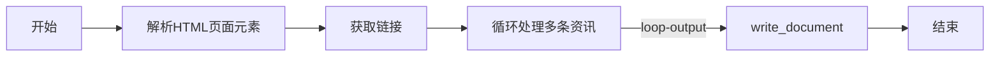

# AI 资讯自动化助手 · Coze 工作流

一条可直接导入 Coze 的资讯采集与汇总工作流，源文件为 Coze 工作流画布复制导出的剪贴板数据。

## 源文件

- [workflow.txt](workflow.txt) — 原始导出文件（约 37 KB，单行 JSON）
- [raw 直链](https://raw.githubusercontent.com/xxy2006-alt/chemai/main/portfolio/ai-news-workflow/workflow.txt) — 适合直接全选复制
- [GitHub 文件页](https://github.com/xxy2006-alt/chemai/blob/main/portfolio/ai-news-workflow/workflow.txt)

## 如何导入 Coze

1. 打开上面的 **raw 直链**（或在 `workflow.txt` 页点 **Raw**），`Ctrl + A` 全选、`Ctrl + C` 复制**全部**文本。
2. 进入 [Coze 工作流](https://www.coze.cn/) 编辑页，新建一条工作流。
3. 在画布空白处 `Ctrl + V` 粘贴，节点与连线会自动还原。

> 需要复制完整 JSON，不能截断；文件为单行，编辑器里显示成一整行是正常的。

## 工作流结构

导出数据包含 **17 个节点、5 条显式连线**。主链路（依据 `json.edges`）：

主要节点：

| 节点 | 在链路中的作用 |
| --- | --- |
| 开始 | 接收输入变量 `url` |
| 解析HTML页面元素 | 代码节点，解析目标页面元素 |
| 获取链接 | 代码节点，生成返回值 |
| 循环处理多条资讯 | 循环体，逐条处理资讯 |
| write_document | 写入文档（纯文本 / Markdown） |
| get_html_class | 目标网页内容解析及核心提取工具 |
| 结束 | 返回 `outputList.msg` |

> 其余节点为循环体内部节点及辅助节点，导出数据中未包含独立连线记录。
